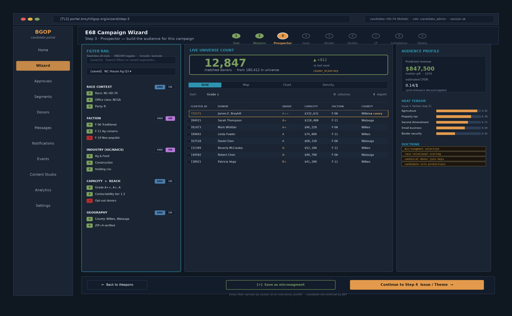
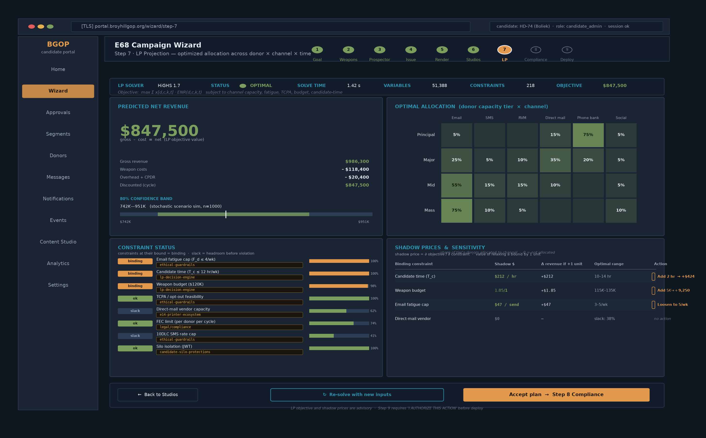

# UI Navigation, Settings, Forms & Math/Stats Algorithm Index

**Scope:** Dataiku DSS 14 + BentoML/MLflow/Feast stack
**Purpose:** Institutional reference for the BroyhillGOP engineering team — every screen, every settings surface, every form field, and every algorithm/statistical function catalogued in one place
**Companion to:** `01_dataiku_technical_audit.md`, `04_bentoml_mlflow_feast_reference_architecture.md`

---

## How to Use This Document

- **Section 1** — Dataiku DSS navigation labels (every menu item you can click)
- **Section 2** — Dataiku DSS settings surfaces (admin + project-level + user-level)
- **Section 3** — Dataiku DSS forms (visual ML design, statistics cards, recipes, API endpoints)
- **Section 4** — BentoML / MLflow / Feast UI navigation and settings
- **Section 5** — Math / statistics / algorithm index (built-in Dataiku library + external via MLflow flavors)
- **Section 6** — Cross-reference: which form uses which algorithm

Companion **HTML index** (`stats_algorithm_index.html`) provides a searchable/filterable version of Section 5.

---

# PART A — DATAIKU DSS

## 1. Navigation Bar Labels

The main navigation bar sits at the top of every project screen. Icons and labels are ordered left-to-right as shown ([Dataiku KB: Navigation bar](https://knowledge.dataiku.com/latest/getting-started/dataiku-ui/reference-navigation-bar.html)).

### 1.1 Flow menu

| Label | Destination |
|---|---|
| Flow | The Flow (visual overview) of the project. From the Flow, you can navigate to any recipe, dataset, model, or other component. |
| Datasets | List of datasets in the project. |
| Recipes | List of recipes in the project. |
| Models & Agents | List of saved models and agents; also where you import new external models. |
| Labeling tasks | List of labeling tasks. Created and managed through the Labeling visual recipe. |
| Streaming Endpoints | List of endpoints that handle continuously streaming data. |

### 1.2 GenAI menu

| Label | Destination |
|---|---|
| Prompt Studios | Visual interface for working with LLM prompts. |
| Agent Tools | Create/edit tools connected to agents. |
| Agents & GenAI Models | Create/edit visual agents and fine-tuned or augmented GenAI models. |
| Dataiku Answers & Agent Connect | Chat interfaces of Dataiku Answers and Agent Connect. |

### 1.3 ML menu

| Label | Destination |
|---|---|
| Visual ML (Analysis) | List of ML models or interactive data preparation created in the Lab. |
| Saved Models | List of models deployed from the Lab to the Flow. |
| Model Evaluation Stores | Collect evaluations that can be used for drift analyses. |
| Model Comparisons | Visually compare multiple evaluations. |
| Experiment Tracking | Store and compare code-based ML models (MLflow-compatible). |

### 1.4 Code menu

| Label | Destination |
|---|---|
| Notebooks | Interactive coding environments (Python, R, SQL). |
| Webapps | Custom applications hosted by Dataiku for advanced visualizations or custom frontends. |
| R Markdown Reports | Generated documents from Markdown + code. |
| Libraries | Library Editor — project-scoped Python/R helpers. |
| Code Studios | Edit code in a full IDE (JupyterLab, RStudio). |

### 1.5 Jobs menu

| Label | Destination |
|---|---|
| Jobs | List of jobs (activities happening in the Flow, such as running recipes or executing code). |
| Scenarios | Automated tasks such as building datasets or training models. |
| Automation Monitoring | Monitor scenario runs via a daily summary or timeline. |

### 1.6 Wiki menu

| Label | Destination |
|---|---|
| Wiki | List of articles to document the project. |

### 1.7 Dashboards menu

| Label | Destination |
|---|---|
| Dashboards | Tools to publish tables, charts, and model reports. |
| Insights | List of elements that can be added to dashboards. |

### 1.8 More Options menu

| Label | Destination |
|---|---|
| API Designer | Build API services that deploy ML models for real-time scoring. |
| Variables | Global or local variables used in recipes, scenarios, and applications. |
| Bundles | Versioned snapshots of the project for deploying to an Automation node. |
| Macros | One-shot actions to maintain the project. |
| Version control | List of commits on the project. |
| Application Designer | Convert the project into a visual app or app-as-recipe. |
| Settings | Project-level settings (tags, integrations, automation, engines, connections). |
| Security | Project-level security (permissions, API keys, shared objects). |

### 1.9 Instance-Level (Home) Navigation

| Label | Destination |
|---|---|
| Projects | List of all projects (filterable, searchable). |
| Workspaces | Cross-project collaborative workspaces. |
| Applications | Deployed Dataiku applications. |
| Project folders | Hierarchical grouping for projects. |
| Dashboards | Instance-level dashboards. |
| Dataiku Apps | Installed applications available for reuse. |
| Waffle menu (⧉) | Data Catalog, Feature Store, Deployer, Govern, Fleet Manager. |

---

## 2. Settings Surfaces

### 2.1 Administration (instance-level)

Path: **Waffle menu → Administration** ([Operating DSS](https://doc.dataiku.com/dss/latest/operations/index.html), [Advanced security](https://doc.dataiku.com/dss/latest/security/advanced-options.html)).

| Section | Screen | Purpose |
|---|---|---|
| **Settings** | General | Instance name, base URL, timezone |
| | Security & Audit | Login policy, session, audit trail |
| | LDAP & SSO | LDAP config, SAML, OIDC, SPNEGO |
| | User login & provisioning → SSO | OIDC / SAML config screens |
| | Notifications | SMTP, Slack, MS Teams |
| | Themes | Instance branding |
| | Misc | Custom pip / conda / R options for code envs |
| | Integrations | Slack, Teams, PagerDuty, Jira |
| | Cluster Management | Spark, K8s clusters |
| | Compute & Scaling | Node pools, container images |
| | Feature Flags | Preview features toggles |
| **Security** | Users | User CRUD, group membership, SYNC (for external users) |
| | Groups | Group CRUD, per-group permissions |
| | Login policy | Password strength, session timeout |
| | Authentication | Auth provider, MFA |
| | API keys | Global keys, personal keys |
| | Audit trail | Query, export, retention |
| **Connections** | Databases | JDBC connections (Postgres, MySQL, SQL Server, Snowflake, BigQuery, …) |
| | Cloud storage | S3, Azure Blob, GCS, Hetzner Object Storage (S3-compat) |
| | Filesystem | Local paths, HDFS |
| | NoSQL | MongoDB, Cassandra, Elasticsearch |
| | Streaming | Kafka |
| | Vendor APIs | Salesforce, HubSpot, Twilio, SendGrid |
| **Code Envs** | Python | Per-env pip requirements, base Python version, container config |
| | R | Per-env R packages, base R version |
| **Plugins** | Installed | List of installed plugins |
| | Store | Marketplace |
| | Development | Local plugin editor |
| **Monitoring** | Instance stats | CPU, RAM, disk, active users |
| | Job history | Instance-wide job list |
| | Logs | DSS backend logs |
| **Deployer** | Design Deployer | Configure design→automation pipelines |
| | API Deployer | Configure API infrastructures |

### 2.2 Project Settings

Path: **More Options → Settings** (in a project).

| Panel | Fields |
|---|---|
| General | Project name, description, image, tags, owner, home dashboard |
| Permissions | Per-group project permissions (see §2.5) |
| Team | Project members, roles |
| Automation | Default scenario, retry policy |
| Engines | Default SQL engine, default ML engine, Spark config |
| Code Envs | Default Python env, default R env |
| Metrics & Checks | Default metrics engines, computation timeout |
| Integrations | Slack/Teams channel per project |
| Time zone | Project-level TZ override |
| Variables | Project variables, exposed to recipes/scenarios |
| Flow Display | Anchor Flow graph, manually position zones, colors |
| API Keys | Project-scoped API keys |

### 2.3 User Profile Settings

Path: **User avatar → Profile**.

| Panel | Fields |
|---|---|
| Profile | Display name, email, avatar |
| Credentials | Per-user connection credentials (used when connections are "Per-user") |
| API keys | Personal API keys |
| Preferences | UI theme, keyboard shortcuts, notifications |
| Two-factor auth | TOTP setup |
| Access tokens | OAuth tokens for integrations |

### 2.4 Dataset Settings

Path: click any dataset → **Settings** (top nav).

| Tab | Fields |
|---|---|
| Connection | Connection, table/path, format-specific options |
| Schema | Column list: name, type, meaning, comment |
| Partitioning | Dimensions, patterns, dispatch |
| Metadata | Label, description, checklists, tags, custom metadata |
| Advanced | Rebuild behavior (Normal / Explicit / Write-protected), virtualization, cache |
| Security | Permissions overrides |

### 2.5 Permission Matrix (Project Level)

From [Main project permissions](https://doc.dataiku.com/dss/latest/security/permissions.html).

| Permission | Grants |
|---|---|
| Read project content | View datasets, recipes, dashboards |
| Read data | Read row-level data (separate from Read content) |
| Write project content | Modify recipes, datasets, models |
| Export data | Download datasets |
| Manage exposed elements | Publish datasets to catalog |
| Manage dashboards | Create/edit/delete dashboards |
| Run scenarios | Trigger scenarios manually |
| Manage scenarios | Create/edit scenarios and triggers |
| Manage additional dashboard users | Grant read-only dashboard access |
| Admin project | Full admin (permissions, API keys, delete) |

---

## 3. Forms Reference

### 3.1 Visual ML — Design Tab

Path: create ML task → **Design**. Sub-panels along the left.

| Panel | Fields |
|---|---|
| **Target** | Target variable (dropdown of columns), prediction type (Two-class / Multiclass / Regression), positive class (for binary) |
| **Train / Test set** | Policy (Random split / Time ordering / Explicit dataset / K-fold), Test set ratio, Random seed, K value |
| **Metrics** | Optimized metric (AUC / F1 / Log Loss / Accuracy / RMSE / MAE / MAPE / R² / Custom), Additional metrics to compute |
| **Features handling** | Per-feature rows with: Role (Input/Reject/Target), Variable type (Numerical/Categorical/Text/Vector), Missing values policy, Rescaling (No rescaling / Standard / MinMax / AvgStd / Robust), Category handling (Dummy / Impact / Target / Ordinal / Cust hash), Text vectorization (TF/IDF / Counts / Hashing), Vector unfold, Custom preprocessing code (Python) |
| **Feature reduction** | None / Principal Component Analysis (n components) / Correlation-based / Tree-based importance |
| **Feature generation** | Pairwise interactions, polynomial features, custom SQL/Python |
| **Algorithms** | Toggle-in list of built-in algorithms (see §5.1) + Add custom model |
| **Hyperparameters** | Per-algorithm form (see §5.1 for parameter tables) |
| **Runtime environment** | Code environment (dropdown), Container / K8s override |
| **Debugging** | Diagnostics enabled toggle, per-fold errors, sub-population analysis |

### 3.2 Score Recipe

Path: create Score recipe from any Saved Model.

| Field | Values |
|---|---|
| Input dataset | dropdown of datasets |
| Model | dropdown of Saved Models |
| Output dataset | dataset name, connection, format |
| Output columns | Include probabilities (per class), Include prediction, Include row-level explanations (SHAP), Include raw prediction |
| Scoring engine | Local (Python) / Local (Optimized-Java) / SQL / Spark |
| Batch size | integer |
| Chunk size | integer (rows per chunk) |

### 3.3 Evaluate Recipe

Path: right-click Saved Model → **Evaluate**.

| Field | Values |
|---|---|
| Input dataset | dataset with true labels |
| Model | Saved Model |
| Metrics | Metric selection (same list as §3.1 Metrics panel) |
| Output metrics dataset | Where to append per-run metrics rows |
| Output scored dataset | Optional — scored predictions |
| Model evaluation store | Which MES to write to |

### 3.4 Prepare Recipe (Data Preparation Steps)

Prepare recipe is a stack of steps. Each step is a form. Categories:

| Category | Sample steps |
|---|---|
| Cleansing | Remove rows if empty, Enrich from URL, Fill empty cells |
| Reshaping | Fold columns to rows, Unfold rows to columns, Pivot |
| Numerical | Round, Binning (equal-frequency, equal-width, custom), Rescaling |
| Categorical | Simplify text, Map values from dictionary, Group values |
| Date | Parse date, Extract components, Compute differences, Format date |
| Text | Simplify, Extract with regex, Tokenize, Normalize |
| Geographic | Extract lat/lng, Reverse geocode, Compute distance |
| Filtering | Filter on formula, Sample, Top N |
| Custom | Formula (DSS formula language), Python function |

### 3.5 API Designer — Endpoint Forms

Path: **More Options → API Designer** → **+ Add endpoint**.

Endpoint types and their form fields:

| Endpoint type | Key fields |
|---|---|
| **Prediction (visual ML)** | Saved Model, Enable "Use Java" (optimized scoring), Enable explanations, Enable feature importance, Custom pre/post-processing code, Input schema, Output naming |
| **Clustering** | Saved Model (clustering), Include cluster label, Include distance |
| **Python function** | Function name, Python code, Requirements, Input schema |
| **R function** | Function name, R code, Requirements |
| **SQL query** | Connection, SQL template with `${parameter}`, Parameter definitions |
| **Dataset lookup** | Dataset, Key column, Return columns |
| **SQL lookup** | Connection, SQL SELECT with `WHERE key = ${key}` |
| **Datasets lookup** | Multiple datasets, join-like config |

Deployment settings on the same screen: pool `floor` / `cruise` / `ceil` / `queue` / `timeout` (see `03_dataiku_api_node_performance_tuning.md`).

### 3.6 Statistics Cards — Card Type Forms

Path: any dataset → **Statistics** tab → **+ New card**.

| Card | Form fields |
|---|---|
| Univariate | Variable(s), Grouping variable (optional), Show summary stats, Show distribution |
| Bivariate | X variable, Y variable, Facet by, Show fit line, Show density |
| Fit distributions | Variable, Distribution (Normal / LogNormal / Exponential / Beta / Gamma / …), Method (MLE / MoM) |
| Fit curves | X, Y, Curve type (Linear / Polynomial / Exponential / Logarithmic / Sigmoid), Confidence interval |
| Correlation matrix | Variables (multi-select), Method (Pearson / Spearman / Kendall), P-values |
| Principal component analysis | Variables, Number of components, Scale to unit variance |
| Statistical test | See §5.5 for every test's form fields |

### 3.7 Scenario Editor Forms

Path: **Jobs → Scenarios → + Create scenario**.

| Section | Fields |
|---|---|
| Triggers | Type (Time-based cron / Dataset change / Explicit / SQL query / Python) + type-specific config |
| Steps | Ordered list; each step is a form: Build / Train / Evaluate / Run Python / Run SQL / Send email / HTTP call / Custom |
| Reporters | Notify on success/failure (Slack, email, Teams, custom) |
| Retention | Log retention days, keep artifacts |
| Concurrency | Max concurrent runs |
| Auto-triggers | On-project-open, on-bundle-activate |

### 3.8 Custom Algorithm Import Form

Path: Design → **Algorithms → Add custom model**.

| Field | Values |
|---|---|
| Algorithm name | free text |
| Description | free text |
| Model class | Python class path (e.g., `donor_models.DonorUpgradeModel`) or inline code |
| Import source | Project library / Global library / Code env |
| Parameters | Key-value grid (name, type, default, choices) |
| Grid search parameters | JSON of hyperparameter grids |

---

# PART B — BENTOML + MLFLOW + FEAST

## 4. UI Navigation & Settings

### 4.1 MLflow UI

Path: `https://mlflow.bgop.internal` (per `04_bentoml_mlflow_feast_reference_architecture.md`).

| Nav | Purpose |
|---|---|
| **Experiments** (left sidebar) | List of experiments; click for run list |
| Run detail | Params, Metrics, Tags, Artifacts, Model, Source, System metrics |
| Compare runs | Side-by-side param/metric table + parallel coordinates plot |
| **Models** (top nav) | List of registered models |
| Model detail | Versions, Stage transitions, Aliases, Tags, Description |
| Version detail | Signature, Metrics, Artifacts, Run link, Stage history |
| **Prompts** (top nav) | Prompt engineering experiments (MLflow 2.x+) |
| **Serving** (top nav, optional) | MLflow model serving dashboards |

**Server settings** (not a UI — CLI/env flags):

| Flag | Purpose |
|---|---|
| `--backend-store-uri` | Postgres/MySQL/SQLite connection string |
| `--default-artifact-root` | S3/GCS/Azure path for artifacts |
| `--host` / `--port` | Bind address |
| `--workers` | Gunicorn workers |
| `--gunicorn-opts` | Extra Gunicorn options (timeouts, worker class) |
| `--serve-artifacts` | Enable artifact proxying |
| `--artifacts-only` | Run only the artifact proxy |

### 4.2 BentoML

BentoML is CLI + programmatic. There is no rich admin UI — dashboards come from Prometheus/Grafana.

**Primary CLI commands:**

| Command | Purpose |
|---|---|
| `bentoml build` | Build a bento from `bentofile.yaml` |
| `bentoml list` | List bentos in local store |
| `bentoml get <tag>` | Show bento manifest |
| `bentoml serve <service>:<tag>` | Run bento locally |
| `bentoml serve <service>:<tag> --production` | Production-mode serve (no autoreload) |
| `bentoml containerize <tag>` | Build OCI image |
| `bentoml delete <tag>` | Remove bento from local store |
| `bentoml models list` | List models saved via `bentoml.mlflow.import_model(...)` etc. |
| `bentoml models push <tag>` | Push to Yatai/BentoCloud (optional) |

**Runtime configuration** (`bentofile.yaml` + `service.py`):

| Setting | Purpose |
|---|---|
| `service` | `module:svc` reference |
| `include` | File globs to bundle |
| `python.requirements_txt` | Locked pip requirements |
| `python.lock_packages` | true → pip freeze at build |
| `docker.distro` | debian / alpine / ubi8 |
| `docker.python_version` | Python version |
| `docker.system_packages` | apt packages to install |
| `docker.env` | Environment vars at runtime |
| `runners` (in `service.py`) | Attached model runners |
| `svc.api(input=..., output=...)` | Endpoint definition (Pydantic / JSON / File / etc.) |

**Metrics endpoint:** `GET /metrics` — Prometheus scrape endpoint on every BentoML pod. See [BentoML metrics docs](https://docs.bentoml.com/en/latest/build-with-bentoml/observability/metrics.html).

### 4.3 Feast

Feast is CLI + Python API + optional Feast UI (`feast ui`).

**Primary CLI commands:**

| Command | Purpose |
|---|---|
| `feast init [-t postgres]` | Scaffold a new feature repo |
| `feast apply` | Sync feature definitions to registry |
| `feast entities list` | List registered entities |
| `feast feature-views list` | List feature views |
| `feast feature-services list` | List feature services |
| `feast on-demand-feature-views list` | List ODFVs |
| `feast data-sources list` | List data sources |
| `feast materialize <start> <end>` | Populate online store from offline for range |
| `feast materialize-incremental <end>` | Incremental materialization |
| `feast registry-dump` | Dump registry contents as JSON |
| `feast serve` | Start online store HTTP server |
| `feast ui` | Launch web UI on port 8888 |
| `feast validate` | Run data quality validations |
| `feast teardown` | Remove all Feast objects (destructive) |

**`feature_store.yaml` settings:**

| Section | Fields |
|---|---|
| `project` | Project name |
| `provider` | `local` / `gcp` / `aws` / `azure` |
| `registry` | Path or SQL URI + `registry_type` |
| `offline_store` | `type` (postgres/bigquery/snowflake/redshift/…) + connection fields |
| `online_store` | `type` (postgres/redis/dynamodb/…) + connection fields, `vector_enabled`, `vector_length` |
| `entity_key_serialization_version` | 2 or 3 |
| `feature_server` | Enable HTTP feature server |
| `flags` | Alpha feature toggles |

**Feast UI navigation:**

| Nav | Purpose |
|---|---|
| Home | Registry summary |
| Data Sources | List of sources + schemas |
| Entities | Entity definitions (join keys) |
| Feature Views | Feature view list, materialization status |
| Feature Services | Composed views for serving |
| Datasets | Saved offline query results |
| Lineage | Data-source → view → service graph |

---


# PART D — BGOP CANDIDATE PORTAL & ADMIN SCREENS

Grounded in current `memory/knowledge/projects/*` wiki entries as of 2026-07-19. Marks each surface as **LIVE**, **CODE-COMPLETE / SQL-HELD**, **DRY-RUN**, or **DESIGN**. This section documents the live UI, not the aspirational spec.

## D1. Frontend Architecture Overview

The BGOP frontend is two distinct UI layers over the same Hetzner PostgreSQL truth source ([broyhillgop wiki](memory/knowledge/projects/broyhillgop.md), [ecosystems note](memory/notes/projects/broyhillgop/ecosystems.md)):

| Layer | Audience | Baseline | Repo path |
|---|---|---|---|
| **Admin Panel** | BGOP staff, NCRDC admins, super_admin | Inspinia template (Vercel + Cursor) | `frontend/inspinia/commander-portal/` |
| **Candidate UI** | Licensed candidate subscribers, campaign managers, volunteers | Inspinia-derived shell, candidate-scoped | `frontend/candidate-portal/`, `frontend/wizard/` |

**Doctrine anchors:** `broyhillgop-frontend-guardrails`, `frontend-inspinia-claude-design`, `frontend-design-system`, `frontend-state-management`, `accessibility`, `candidate-silo-protections`.

**Silo rule** (see §D6): every screen in the Candidate UI is scoped by `candidate_id` from the JWT. The Admin Panel can cross candidates only when the caller's role is `super_admin` or `ncrdc_admin` (per `auth-rbac`).

## D2. Candidate Portal (E25 Service Cockpit)

**Status:** Deploy #5 brought E25 up on Hetzner as HTTP on `127.0.0.1:8083` (27 paths exposed, `/healthz` = 200). Deploy #7 pending on `portal.broyhillgop.org` DNS pointing at Hetzner ([candidate-subscriber-portal wiki](memory/knowledge/projects/candidate-subscriber-portal.md)).

### D2.1 Sidebar Navigation

| Label | Route | Status | Ecosystem | Purpose |
|---|---|---|---|---|
| Home / Dashboard | `/` | LIVE | E25 | Candidate overview, top microsegments, week's key actions |
| Wizard | `/wizard` | LIVE (Steps 1, 2, 4, 5, 9) | E68 | Campaign planning + activation flow (see §D3) |
| Approval Queue | `/approval-queue` | DESIGN | E68 + E20 | Ranked ready-to-fire actions (approve / reject / defer) |
| Microsegments | `/segments` | LIVE (picker) | E59 | Searchable microsegment picker, ~32 implemented, ~198K assignments |
| Donor Explorer | `/donors` | LIVE | E01 + E25 | Donor detail pages, capacity/grade/faction visible per candidate scope |
| Messages | `/messages` | CODE-COMPLETE / SQL-HELD | E36 | Unified inbox — donor, brain, campaign messages |
| Notifications | `/notifications.html` | LIVE | E36 | Notification stream (brain triggers, approvals waiting, drift alerts) |
| Events | `/events` | LIVE | E39 + E58 | Event Revenue Engine, Finance Committee, Circuit Breaker, Event Analytics |
| Content Studio | `/studio` | LIVE (E68 Step 6 hub) | E70 + E68 | Weapon-specific studios: email, SMS, RVM, direct mail, social, phone bank |
| Weekly Edition | `/weekly` | DESIGN | E71 | Sunday broadcast assembly + volunteer share |
| Analytics | `/analytics` | DESIGN | E01 + E42 | KPI dashboards, issue radar, cross-candidate tests |
| Documents | `/documents` | DESIGN | E25 | Onboarding + deliverables + subscription-status archive |
| Settings | `/settings` | LIVE | E25 | Candidate profile, silo prefs, MFA, TCPA consent |
| Support | `/support` | DESIGN | E25 | Support ticket cockpit — no direct backend access |

### D2.2 Home / Dashboard Widgets

Recommended-approval tiles (see `approval-queue-architecture` doctrine), each summarizing facts, AI-generated response, and CTA:

| Widget | Content |
|---|---|
| Top microsegments today | Ranked by heat × capacity, filtered to candidate silo |
| Approval queue count | # of pending items with predicted revenue, deadline, ROI |
| Weekly edition status | Draft state, one-tap approve, scheduled Sunday send |
| Advocacy Network activity | New endorsements, push-forward shares, member profile changes |
| Donor community feed | Latest donor questions, posts, poll results |
| KPI card | This week's raised, LTV growth, contact-fatigue, silo health |
| Streak / readiness | Days-active streak, readiness score (per `addiction-mechanics-and-kpis`) |

### D2.3 Donor Explorer — Screen Structure

- **List view** — Filter rail (Seamless.AI-style, per §D3.4) + result grid with donor grade, cluster_id, capacity, last-gift days, faction
- **Detail page tabs** — Overview, Giving history, Contactability, Faction, Household, Address / geocoding, Grade & scoring, Advocacy activity, Communications history, Audit log
- **Actions** — Add to microsegment, generate ask card, send to approval queue (never direct-send)

Cross-candidate lookups are blocked at the middleware layer (`common/silo.py` in the BentoML services, per `candidate-silo-protections`).

## D3. E68 Campaign Wizard — Screen Flow

The Wizard is the candidate's central planning and activation surface ([e68-campaign-wizard wiki](memory/knowledge/projects/e68-campaign-wizard.md)). Live UI files under `frontend/wizard/` and `frontend/candidate-portal/`.

### D3.1 Wizard Steps

| Step | Screen | Status | Purpose | Doctrine anchors |
|---|---|---|---|---|
| Home | `wizard/index.html` | LIVE | Wizard launcher, run history | `frankenstein-best-architecture`, `onboarding-flow` |
| Step 1 | Goal | LIVE | Fundraising / campaign objective definition; binds to LP + NBD | `lp-decision-engine` |
| Step 2 | Weapons | LIVE | Channel-weapon selection (email, SMS, RVM, direct mail, social, phone bank) | `waterfall-orchestration-engine` |
| Step 3 | Prospector | DESIGN | Race category + issue/theme + constituency + community + neighborhood + individual aggregates → live universe counts | `microsegment-selection`, `race-relational-scoring` |
| Step 4 | Issue / Theme | LIVE | Bind campaign to issue codes; heat-fill from E42 | `heat-tensor-scoring`, `issue-polarity-mapper` |
| Step 5 | Rendering | LIVE | Per-weapon content preview and render | `content-generation-guidelines`, `candidate-voice-fingerprint` |
| Step 6 | Studios hub | LIVE | Opens channel-specific studios (email, SMS, RVM, mail, social, phone) — each must be rendered, reviewed, approved | `broyhillgop-message-review`, `ethical-guardrails` |
| Step 7 | LP projection | DESIGN | Shows LP solver output: predicted revenue, shadow prices, sensitivity analysis | `lp-decision-engine`, `advanced-decision-modeling` |
| Step 8 | Compliance check | DESIGN | TCPA, FEC, 10DLC, fatigue caps verification | `ethical-guardrails`, `legal/compliance` |
| Step 9 | Review / Deploy | LIVE | Final review + `I AUTHORIZE THIS ACTION` gate → E30 `/api/e30/create-from-wizard` | `authorization-protocol` |

### D3.2 Step 3 Prospector — Seamless.AI-Style Filter Rail



**Figure D3.2** — Wireframe of Step 3 Prospector. Three columns: filter rail (Seamless.AI-style with per-group AND/OR toggles and include/exclude chips), live universe count with results grid (rows outlined in yellow when they hit the sacred canary), and right panel showing predicted revenue, heat-tensor mini-viz, and doctrine anchors. Sidebar shows Wizard active; the 9-step progress bar has Steps 1–2 completed and Step 3 highlighted. Bottom action bar: Back to Weapons, Save as microsegment, Continue to Step 4.

Three-zone filter rail (see [e59 wiki](memory/knowledge/projects/e59-microsegment-intelligence.md)):

| Zone | Fields | Behavior |
|---|---|---|
| **Search bar** | Free-text + saved-search dropdown | Boolean AND/OR/NOT |
| **Filter rail (left)** | Category chips: race, issue, faction, industry, capacity tier, contactability tier, geography, household, veteran, endorsement history | Per-filter AND/OR toggles, include/exclude row logic |
| **Result universe (main)** | Live universe count (animated), grid of matching donors, save-as-microsegment CTA | Recomputes on every filter toggle |

### D3.3 Step 6 Studios — Three-Pane Layout

Per the Master Platform Plan demo:

| Pane | Content |
|---|---|
| Left | Template library (per-weapon), saved drafts |
| Middle | Live preview (candidate-voice-scored, per `candidate-voice-fingerprint`) |
| Right | AI recommendation panel + cost estimate + `broyhillgop-message-review` flags |

### D3.4 Step 7 LP Projection — Decision-Engine Output



**Figure D3.4** — Wireframe of Step 7 LP Projection. Top strip: LP solver status (HiGHS 1.7, OPTIMAL, solve time, variable/constraint counts, final objective value) with the objective function shown inline. Four-panel body:

- **Predicted Net Revenue** — headline number, gross/cost/discount breakdown, 80% confidence band from stochastic scenario simulation (n=1000).
- **Optimal Allocation** — heat map of the LP solver's donor-tier × channel assignment matrix. Principal-tier donors get phone bank + direct mail; Mass tier gets email + social.
- **Constraint Status** — every constraint with a status pill (binding / ok / slack), utilization bar, and the doctrine skill that governs it. Binding constraints are the ones the LP wants to relax.
- **Shadow Prices & Sensitivity** — per-binding-constraint marginal value ($ per unit relaxed), delta revenue if +1 unit, optimal range for that constraint, and a suggested action (e.g., "Add 2 hr → +$424"). Non-binding constraints show `no action`.

Bottom action bar: Back to Studios, Re-solve with new inputs, Accept plan → Step 8 Compliance. The footer reminds operators that the LP is advisory only — Step 9 still requires the exact-phrase `I AUTHORIZE THIS ACTION` gate per `authorization-protocol`.

**Doctrine anchors on this screen:** `lp-decision-engine`, `advanced-decision-modeling`, `ethical-guardrails` (fatigue caps, TCPA, 10DLC), `legal/compliance` (FEC limits), `e14-printer-ecosystem` (direct-mail vendor capacity), `candidate-silo-protections` (JWT isolation).

## D4. E59 Microsegment Intelligence — Screen

**Live prototype** at `frontend/inspinia/commander-portal/e59-prototype/` ([e59 wiki](memory/knowledge/projects/e59-microsegment-intelligence.md)):

| Screen area | Content |
|---|---|
| Segment picker | Search box + saved-search list + segment cards showing size, LTV, heat score |
| Filter rail | AND/OR toggles per filter, include/exclude row logic, live match counter |
| District matrix | 64-column view over `intelligence.district_tag_matrix` |
| Issue Explorer | District-level affinity, donation forecast per issue |
| Volume Conductor | Reusable 1–100 dial for heat / capacity / propensity / fatigue / TCPA / LP budget |
| Ring test panel | Ring 1–4 launch gates, predicted-vs-actual logging, hold triggers |

## D5. E36 Unified Inbox — Screen

**Status:** frontend + API live; SQL migrations SQL-HELD ([e36 wiki](memory/knowledge/projects/e36-unified-messaging.md)).

Files: `frontend/candidate-portal/ecosystem-messenger.html`, `frontend/candidate-portal/notifications.html`, `backend/python/api/unified_inbox_api.py`.

| UI element | Purpose |
|---|---|
| Inbox list | Combined donor, brain-trigger, campaign, and system messages |
| Thread view | Per-thread history, reply composer (SMS-held), attachments |
| Notification stream | Brain trigger fires, approvals waiting, drift alerts |
| Filters | By channel, by donor, by priority, by unread |
| Actions | Reply, forward to staff, escalate, close, snooze |

## D6. Admin Panel (Staff / NCRDC View)

**Baseline:** Inspinia template; screens are role-scoped (`super_admin`, `ncrdc_admin`, `candidate_admin`, `staff`).

### D6.1 Admin Sidebar

| Label | Purpose | Min role |
|---|---|---|
| Command Center | Instance-wide dashboard: canary, queue depth, blockers | `staff` |
| Candidate Directory | List of licensed candidate silos + subscription state | `ncrdc_admin` |
| Silo Health | Per-candidate silo isolation status, RLS policy check | `ncrdc_admin` |
| Approval Queues | Cross-candidate view of pending approvals (aggregate) | `staff` |
| Model Registry | MLflow-mirror: registered models, versions, stages, drift status | `staff` |
| Governance | `ml_gov.model_card`, approval events, exact-phrase log | `ncrdc_admin` |
| Brain Triggers | `brain.triggers` CRUD + firing history | `staff` |
| Ingestion (E61) | Upload lanes, schema fingerprints, quarantine queue | `staff` |
| Deploy Log | Deploys #1..N, live-state ledger, executed-record PRs | `super_admin` |
| Vendor Config | LettrLabs / SendGrid / Twilio / Drop Cowboy / WinRed presets | `ncrdc_admin` |
| Users & Groups | User CRUD, role assignment, MFA enforcement | `super_admin` |
| Audit Trail | `ml_audit.prediction_log`, action logs, exports | `super_admin` |
| Kill Switch | Emergency stop per ecosystem + per candidate | `super_admin` |

### D6.2 Command Center — Home Widgets

Machine-readable state per `platform-status-oracle`:

| Widget | Source | Alert threshold |
|---|---|---|
| Canary status | `ml_audit.canary_check` hourly | Any deviation from 147 txns / $332,631.30 |
| Queue depth per API | Prometheus / BentoML `/metrics` | > 4 sustained |
| Missing tables | Platform Status Oracle | Any missing critical table |
| Blocker count | GitHub issues + PR audit | > 5 open P0 |
| Send-freeze status | E30 kill switch | Freeze ON / OFF |
| Live-state deploy ledger | Executed-record PRs | New deploy in last 24h |
| Drift alerts | `ml_gov.drift_report` | PSI > 0.25 on any model |
| Silo integrity | 403 count by caller | Any silo violation |

### D6.3 Approval Queue (Admin View)

Structured per `approval-queue-architecture`:

| Column | Content |
|---|---|
| Predicted revenue | LP-solver output |
| Cost | Weapon-mix cost estimate |
| ROI | Revenue / cost |
| Deadline | Time-window before expiration |
| Fact card | Donor + issue + heat evidence |
| AI response | Generated content with voice-fingerprint score |
| CTA | Approve / Reject / Send back / Defer |
| Scale | 1:1 / small group / microsegment |
| Doctrine tags | `donor-centric-architecture`, `race-relational-scoring`, etc. |

## D7. E64 Conversion Surface — Candidate-Facing Screens

**Status:** Native funnel controller live on port 8084 (deploy queued), landing pages served via `give.broyhill.gop` ([e64 wiki](memory/knowledge/projects/e64-conversion-surface.md)).

The E64 surface is what the **donor** sees after clicking a weapon link. For completeness in this UI catalog, the five behavioral steps:

| Step | Psychological function | Content |
|---|---|---|
| 1 | Resonance confirmation | "You said X matters — here's proof this candidate delivers on X" |
| 2 | Risk reduction | Reassurance, endorsements, faction/access-tier anchoring |
| 3 | Decision trigger | Ask-amount elasticity–calibrated donation form |
| 4 | Identity elevation | Access-tier content matrix (event open / full / absent) |
| 5 | Commitment + handoff | WinRed / Anedot handoff, referral workflow, influence-score bump |

## D8. E39 / E58 Event Fundraiser Surfaces

**Status:** PR #80 added frontend surfaces with live Vercel preview.

Surfaces: Event Revenue Engine, Finance Committee, Circuit Breaker, Event Analytics — nine-phase pipeline per `event-fundraiser-pipeline`:

| Screen | Purpose |
|---|---|
| Event list | Upcoming / past events per candidate silo |
| Host Recruitment (T-90) | Host list, outreach queue |
| Co-Host List Build | Prospector-style list build |
| Save the Date | Draft, review, send |
| Printed Invitation | LettrLabs vendor routing |
| Reminder Waterfall | Multi-channel waterfall configurator |
| RSVP + Yield | Attendance forecast |
| Post-Event Stewardship | Stewardship task list |

## D9. Advocacy Network Layer (E25/E26)

Added by PRs #150, #153, #154, #156, #157 — two-sided flywheel:

| Screen | Purpose |
|---|---|
| Member profile | Donor / volunteer self-profile |
| Ranked feed | Tattoo-ranked (donor, candidate, opponent, district) content |
| Candidate spaces | Per-candidate discussion / endorsement forum |
| Endorsement flow | Push-forward sharing + endorsement issuance |
| First-visit telemetry | E64 curiosity writeback to E25 |
| Push-forward tracking | Attribution back to originating donor / volunteer |

## D10. Keyboard Shortcuts (Inspinia + BGOP overlay)

| Shortcut | Action |
|---|---|
| `g + f` | Go to Flow / Home |
| `g + w` | Go to Wizard |
| `g + s` | Go to Segments (E59) |
| `g + m` | Go to Messages (E36) |
| `g + a` | Go to Approval queue |
| `g + n` | Go to Notifications |
| `?` | Open shortcut cheatsheet |
| `⌘/Ctrl + s` | Save current form |
| `⌘/Ctrl + k` | Global search |

---


# PART E — MULTI-CANNON ORCHESTRATION MATRIX

**Grounded in three canonical BGOP docs:**
- `DONOR_INTENT_ENGINE_VARIANCE_DOCTRINE_2026-07-07.md` — variance-driven intent calculation + 4-gear volume regulation
- `MOMENTUM_SCORING_MODEL_SPEC_v0.1_2026-06-29.md` — momentum scoring (7 signals) + 4 gears (OBSERVE / WARM / ENGAGE / MAXIMUM THRUST) + funnel counts per gear
- `E68_WIZARD_VISUAL_SPEC_v1_2026-07-07.md` — Casting Call, Cannon Deck, gear dial, Playbill (candidate-facing control surface)

**Doctrine anchors:** `lp-decision-engine`, `waterfall-orchestration-engine`, `news-driven-heat-quantification`, `event-fundraiser-pipeline`, `campaign-heat-response-system`, `heat-tensor-scoring`, `donor-contribution-forecasting`, `ask-amount-elasticity`.

**Scope:** the orchestration layer that ties heat, intent, gears, weapons, funnels, and variance into one closed-loop calculating machine. This is the layer that decides *which* of the ~10,000 sleeping microsegments light up, *which* funnels fire, *which* weapons discharge, *when*, *in what sequence*, and *how hard* — and then audits the whole thing daily against the variance ledger.

---

## E1. Weapon Taxonomy — The 16 Cannons

The cannon roster is stored as **genome data** in the Salesbook play library (per E68 wizard doctrine §5.1), not hardcoded — the roster count is currently under open ruling (16 in Intent Engine doctrine vs 18 in Ed's 2026-07-07 session, with Directive Cannons #14/#15 numbering). This document uses the canonical 16 count.

Each cannon carries **munition types**, **blast radius**, **cadence rules**, and **cost profile**.

| # | Cannon | Ecosystem | Munitions | Blast radius | Min gap | Max per funnel | Cooldown | Unit cost |
|---|---|---|---|---|---|---|---|---|
| 1 | **Email** | E30 | drip, blast, personalized, single-issue | 1 | 24 h | 8 per 30 d | 12 h | $0.02 |
| 2 | **SMS** | E31 | single, threaded, iMessage variant | 1 | 48 h | 3 per 30 d | 24 h | $0.04 |
| 3 | **MMS** | E31 | image, short video, GIF | 1 | 72 h | 2 per 30 d | 48 h | $0.08 |
| 4 | **RVM** (ringless voicemail) | E17 | candidate voice, staff voice, celebrity endorsement | 1 | 5 d | 2 per 30 d | 72 h | $0.03 |
| 5 | **Direct mail #10** | E14 | standard letter, personalized letter, invitation | 1 | 7 d | 3 per 90 d | 5 d | $0.85 |
| 6 | **Direct mail oversize** | E14 | oversize invitation, packet, handwritten note (LettrLabs) | 1 | 14 d | 2 per 90 d | 10 d | $2.20 |
| 7 | **Social organic** | E19 | candidate post, boosted, story, reel | ~50 (network amp) | 6 h | 30 per 30 d | 1 h | $0.15 CPM |
| 8 | **Social paid** | E19 | targeted ad, lookalike ad, retargeting | 100+ | 12 h | 12 per 30 d | 6 h | variable |
| 9 | **Phone bank** | E32 | volunteer call, staff call | 1 | 7 d | 2 per 30 d | 5 d | $4.20 |
| 10 | **Candidate personal touch** | E75 | handwritten note, personal call, house visit | 1 | 30 d | 1 per 90 d | 21 d | staff time |
| 11 | **Event invitation** | E39/E58 | save-the-date, formal invite, reminder | ~5 (household + peers) | 14 d | 3 per event | 7 d | $1.50–5.00 |
| 12 | **Landing page (E64 funnel)** | E64 | personalized, faction-anchored, ask-ladder-tuned | 1 | on-click only | unlimited | 0 (pull) | $0 marginal |
| 13 | **Weekly edition / portal** | E25/E26 | issue digest, personalized feed, poll | 1 | 7 d | 4 per 30 d | 6 d | $0 marginal |
| 14 | **IVR / robo-inbound** | E35 | menu, callback capture, town-hall dial-in | 1 | on-inbound | unlimited | 0 | $0.02/min |
| 15 | **Peer / bundler push** | E71 | volunteer share, endorsement post | ~15 (peer network) | 3 d | 8 per 30 d | 24 h | $0.05 |
| 16 | **Print insert / newspaper** | E14 | endorsement ad, event listing | 500+ (impression) | 30 d | 1 per 30 d | 14 d | $0.001 CPM |

**Blast radius** = expected number of donors touched per firing (candidate donor + peers + household + coalition). Social organic and paid can hit 50-100+; direct/personal cannons hit 1. This matters because **fatigue caps and cooldowns apply per-donor across all cannons touching them**, not per-cannon.

**Munition types within a cannon** further parameterize the firing:
- *Standard* — the default arm
- *Personalized* — cluster_id-scoped substitutions (voice-fingerprint-scored)
- *Faction-anchored* — 25-faction routing (per `donor-faction-assignment`)
- *Access-tier* — event-open / event-full / no-event variant (per E64 doctrine)

## E2. Funnel Model — Time-Sequenced Multichannel Programs

**A funnel is a planned time-sequenced multichannel weapon program.** Arbitrary length, arbitrary weapon mix, arbitrary spacing. Any of these shapes are valid funnels:

- **1-touch**: birthday email at T+0 (single weapon, single moment)
- **Short sequence**: email T+0 → SMS T+3 → email T+7 → phone bank T+14
- **Long-running**: DM T+0 → email T+2 → email T+7 → SMS T+10 → RVM T+14 → email T+21 → phone bank T+30 → event invite T+45 → mail T+60
- **Adaptive**: next step chosen by pulse-machine reading of steps 1-3
- **Blast-radius > 1**: peer-bundler weapons targeting the donor's spouse / neighbors / peers within the same funnel
- **Multi-cannon-per-tick**: T+7 fires email AND SMS in the same window

Each funnel in the Salesbook library is stored as a **play genome** with:

```yaml
play_id:               P-501
name:                  "Harris gala runway"
category:              event_fundraiser
audience_filter:       # SQL against microsegment
weapons:               # ordered sequence
  - weapon: direct_mail_oversize
    munition: formal_invite
    at: T+0
    gate: capacity_tier in (A++, A+, A)
  - weapon: email
    munition: personalized
    at: T+3
    variant_set: [A, B]   # bandit arms
  - weapon: sms
    munition: single
    at: T+7
    conditional: no_response_step_2
  - weapon: phone_bank
    munition: staff_call
    at: T+10
    conditional: no_rsvp_step_3
sequencing_rules:
  min_gap_between_fires: 48h
  max_touches_total: 6
  respects_fatigue: true
  respects_quiet_hours: true
lp_constraints:
  budget_ceiling: $5,000
  candidate_time: 2h
  channel_capacity: [phone_bank_slots >= 20]
success_criteria:
  goal_event: RSVP
  fallback_event: donation
  timeout: T+30
```

## E3. Funnel Instance State Machine

A funnel *template* becomes a funnel *instance* when instantiated for a specific donor × microsegment × candidate. The instance runs through this FSM:

```
  template (in library)
      │
      │ (Wizard "Showtime" or E20 auto-trigger)
      ▼
  armed  ─── sequence planned, first step scheduled, LP budget reserved
      │
      ▼
  mid-flight ─── some steps fired, others queued
      │  ↑
      │  │ (pulse machine says HOLD;
      │  │  waiting for consistency or fatigue window)
      ▼  │
  paused
      │
      ▼
  re-planning ─── adaptive sequence deciding next step from pulse read
      │
      ▼
  firing ─── a weapon is discharging right now (this tick)
      │
      ▼
  cooling ─── last step fired, salience decay window
      │
      ▼
  completed ─── all steps executed, exit criteria met
                │
                ▼
            post-mortem ─── revenue attributed, variance posted,
                            training signal to E20 / Intent Engine

  aborted  ← reached from ANY state on:
             • compliance event (opt-out, TCPA violation)
             • silo violation (JWT rejection)
             • Ed's kill switch
             • fatigue ledger overflow
             • Gear -4 handbrake on parent activity
```

**Every state transition writes to `brain.funnel_instance_events`** (audit trail per `broyhillgop-doctrine`). Post-mortem writes to the variance ledger.

**Adaptive re-planning** is where the pulse machine matters: after each step fires, the pulse read (open? click? donate? no response?) is fed to the bandit, which decides the next step's arm (or whether to pause / abort).

## E4. The Volume Gearbox — 4 Up, 4 Down (Canonical)

Per the Donor Intent Engine Variance Doctrine §4. Every activity (play × segment × cannon) carries a **volume dial 0-100** (% of eligible universe worked per day). The variance machine shifts through a 4-gear transmission in each direction.

### E4.1 Upshifts (persistence-gated)

| Gear | Move | Trigger (variance magnitude × persistence) |
|---|---|---|
| **+1 nudge** | dial +5 | favorable variance 1σ–2σ, 1 day |
| **+2 step** | dial +15 | favorable > 2σ, 2 consecutive days |
| **+3 surge** | dial +35 | favorable > 3σ sustained 3+ days, or heat-spike × favorable combo |
| **+4 THROTTLE / 1812 OVERTURE** | → 100 | exceptional: proven play + peak window (GOTV, deadline, matching) |

### E4.2 Downshifts (asymmetric — safety wins)

| Gear | Meaning | Move | Trigger |
|---|---|---|---|
| **-1 nudge** | volume too high, message fine | dial −5 | unfavorable 1σ–2σ, 1 day |
| **-2 step** | **change the subject** — message is wrong, not volume | dial −15 | unfavorable > 2σ, 2 consecutive days |
| **-3 surge** | **change the play** — whole strategy misread the segment | dial −35 | unfavorable > 3σ, or CPDR breach |
| **-4 STOP / handbrake** | **stop talking** | → 0 | compliance event, opt-out spike, oversight auto-pause, canary anomaly — **instant, no persistence requirement** |

**Rules of the gearbox:**

- Upshifts require **magnitude × persistence** (proof, not enthusiasm)
- **-4 requires no persistence** (safety is asymmetric)
- Every dial move logged with variance evidence that caused it (auditable, like a journal entry)
- E73 LP re-solves with the new dial as a **cap**
- Thompson keeps a small **exploration floor** (dial never locks at 0 for non-compliance reasons — a trickle arm keeps learning)
- Dial changes above ±2 **notify the command center**; ±4 in either direction **pings candidate/staff**

### E4.3 -2 "Change the Subject" Rotation Strategies

The doctrine explicitly names two rotation strategies for -2:

- **(a) Clean swap** — drop the old subject, open the next-ranked angle from the why-vector
- **(b) Contrast escalation** — bridge off the failed subject into a hotter one: *"you think that was bad — look at THIS"*. Preferred when the audience engaged (opened / clicked) but didn't convert — **attention exists, the stakes were too low**.

The bandit runs both as arms; the variance ledger picks the winner.

### E4.4 Gear +4 "1812 Overture" — Coordinated 16-Gun Volley

Not "more of the same gun louder." Gear +4 is the **cannon volley** — the finale where the full arsenal fires *in coordinated score* on a segment at the moment of decision.

**Entry gate (all required):**
- 1 → 2 → 3 climb sustained (proof of intent, not enthusiasm)
- Fatigue ledger in-range
- E73 LP budget clearance
- Candidate / staff notification ping

**Orchestration (not simultaneous spam):**
```
RVM in candidate voice   → SMS with the LP link  → email with the full case
→ phone call to top tier → strategic plea (moment of decision, the cannon shot)
```
One theme, every channel, timed crescendo. The fatigue ledger still counts every touch; the volley budget is spent as one coordinated arc, not 16 independent caps.

**Time-boxed:** 24–72 h finale window, then automatic downshift to sustain gear; segment graduates to a **resident cultivation play** (gratitude, insider updates) so the crescendo banks relationship, not burnout.

**Redline:** opt-out / complaint spike during the volley = **instant -4 handbrake**, overriding the finale.

### E4.5 Engine Braking at 100 mph

A downshift is controlled deceleration, not a crash:

1. **New dispatches halt** — throttle closes before anything else
2. Queued-but-unsent work is cancelled
3. Mid-flight sends follow per-channel rules (a batch already at the carrier completes; the next wave never leaves)
4. **The inbound side never brakes** — callbacks, IVR, opt-out capture keep running at full capacity regardless of dial position
5. Successive downshifts bleed volume in order (100 → 65 → 50 → 45 …)
6. **-4 is the handbrake**: dial to 0 immediately, no wave drain, no persistence requirement
7. Momentum is preserved as information — everything still in flight during deceleration posts variances, so the brake event itself feeds the model

## E5. MPI — Microsegment Propensity Intensity

Per Variance Doctrine §2b. The engine's published output score is `MPI-<class> <propensity>/<intensity>`, e.g. `MPI-G 74/8`.

- **M** — Microsegment (race-relational; graded against the matchup per the 40% Rule)
- **P** — Propensity: calibrated P(act now), 0–100 (a cohort scored 74 must realize ≈74% of standard — variance ledger audits this daily)
- **I** — Intensity: 1–10 magnitude × commitment (expected amount at the ask-ladder point × multi-level-interaction multiplier)

**Four MPI classes, each with its own LP formulation** (same E73 solver, class-specific objective + constraints):

| Class | Objective (maximize) | Binding constraint rows |
|---|---|---|
| **MPI-G** (give) | Σ p_give · expected_amount | budget, fatigue caps, channel capacity, compliance zeros |
| **MPI-R** (RSVP) | Σ p_rsvp (seats filled) | event capacity, invite-window timing, fatigue |
| **MPI-V** (volunteer) | Σ p_vol (shifts filled) | shift slots, geography/travel, task-preference match |
| **MPI-C** (callback) | Σ p_callback (conversations) | IVR/agent capacity, callback-window hours, fatigue |

**Dials are per (class × activity)**: a segment can be gear +3 on MPI-R (event next week) while gear -1 on MPI-G (just gave). The fatigue ledger arbitrates across classes so the donor never feels all four dials at once.

## E6. Momentum Scoring — The 7-Signal Convergence Engine

Per Momentum Scoring Model Spec v0.1. Momentum is the **quantifiable confirmation that 3+ independent behavioral signals are converging in the same direction** for a candidate × microsegment × 48-hour window.

**Independence rule:** signals must come from **causally separate** behavioral pathways. Email open + click are NOT independent (count as 1). Email open + social repost + portal return visit ARE independent (count as 3).

### E6.1 The 7 Independent Signals

| # | Signal | Threshold | Points | Source |
|---|---|---|---|---|
| 1 | Conversion Rate | > 2.0× 30-day baseline | 15 | WinRed/Anedot → `social.feed_events` |
| 2 | Email Open Rate | > 1.5× 30-day baseline | 10 | `social.feed_events.opened_at` |
| 3 | Social Amplification | > 3.0× 7-day average shares | 12 | `social.volunteer_shares` |
| 4 | Heat Tensor Score | > 75/100 on dominant issue | 15 | `e63.heat_tensor` |
| 5 | Portal Engagement Surge | > 40% dwell increase OR > 20% return visits | 10 | `social.donor_engagement_scores` |
| 6 | Peer Conversion Cluster | ≥ 3 from same ZIP / employer / coalition in 48h | 18 | `core.donor_profile` + feed_events |
| 7 | RFM Recency Surge | Lapsed donors (>90d) reactivating > 2.5× baseline | 10 | `core.donor_profile.last_gift_date` |

### E6.2 Composite Score

```
base_score = Σ points_for_confirmed_signals

convergence_bonus:
  signals from 3+ different behavioral channels → +8
  signals from 2 different channels           → +3

final_score = min(100, base_score + convergence_bonus)
```

**Channels** for the convergence bonus:
- Financial (signals 1, 6, 7) · Email (2) · Social (3) · News (4) · Portal (5)

### E6.3 Score → Gear Action Table

| Score | Signals | Level | Dial action | Wizard card |
|---|---|---|---|---|
| 0 | 0 | None | Normal ±5 cycle | None |
| 10-18 | 1 | Weak | Monitor only | None |
| 20-33 | 2 | Building | Normal cycle, upward bias | None |
| 35-52 | 3 | **MOMENTUM** | Jump ±15 | Standard card |
| 53-70 | 4 | **STRONG** | Jump ±25 | Priority (4h expiry) |
| 71-82 | 5 | **HIGH** | Jump ±30 | **URGENT (2h expiry)** |
| 83-90 | 6 | **SURGE** | Full gear jump | **URGENT (1h expiry)** |
| 91+ | 7 | **MAX SURGE** | Maximum thrust | **URGENT immediate** |

## E7. The Named-Gear Doctrine (E68 Wizard Vocabulary)

The candidate-facing gear dial has four named stops per E68 Wizard §5.2 (four cinema-theatrical labels replace numeric gears at the Tier B / candidate layer):

| Numeric gear | Wizard name | Semantics | Cannons lit | Funnels active |
|---|---|---|---|---|
| Gear 1 (0-25) | **whisper** | OBSERVE only, no outbound | 0 | 0 |
| Gear 2 (26-50) | **matinee** | WARM: light acceleration, soft touches | 2-3 | 1-2 from library |
| Gear 3 (51-75) | **premiere** | ENGAGE: multi-channel deployment | 5-7 | 3-5 simultaneous |
| Gear 4 (76-100) | **the 1812 Overture** | MAXIMUM THRUST: coordinated volley | up to 16 | full high-PCV roster |

**Moving the gear dial in the Cannon Deck (E68 §5.2):**
1. Re-lights the 16-cannon board (which tiles are lit / dark / gated)
2. Re-computes the Box Office (audience, cost, projected response, forecast revenue, net, confidence band)
3. Regenerates the firing timeline (running order)

## E8. Extended LP Formulation — Sequencing + Blast-Radius + Fatigue

The core LP (§5.14.1 of the algorithm index) maximizes Σ ENR over (donor × candidate × channel × time). The orchestration matrix extends this in three ways:

### E8.1 Sequencing Constraints

For every funnel instance F with ordered steps (s₁, s₂, …, sₙ) using cannons (k₁, k₂, …, kₙ) at times (t₁, t₂, …, tₙ):

- **Precedence:** \( x_{d,F,s_{i+1}} \le x_{d,F,s_i} \) for all i (can't fire step i+1 without step i)
- **Min gap:** \( t_{i+1} - t_i \ge \Delta_{\min}(k_{i+1}) \) (respect per-cannon min gap from E1)
- **Max sequence length:** \( \sum_i x_{d,F,s_i} \le \text{max\_touches\_total} \) (from funnel play genome)

### E8.2 Blast-Radius Overlap Penalty

When two funnels F, F′ overlap in blast radius (e.g., both target the donor's spouse), add penalty term:

\[
\text{Penalty}(F, F') = \lambda \cdot |\text{Blast}(F) \cap \text{Blast}(F')| \cdot \overline{\text{Fatigue}}(\text{overlap})
\]

Where λ is the overlap-aversion coefficient and Fatigue is the average fatigue score of donors in the intersection. This discourages hammering the same household through two funnels at once.

### E8.3 Cross-Funnel Fatigue

For each donor d in any window W:

\[
\sum_{F} \sum_{k \in F} \sum_{t \in W} x_{d,F,k,t} \cdot \text{fatigue\_cost}(k) \le F_d(W)
\]

Where F_d(W) is the donor's fatigue budget for the window, tightened when they're already receiving other funnels.

### E8.4 Gear-Cap Constraint

The dial position for activity (play × segment × cannon) enters the LP as an **upper bound on utilization**:

\[
\sum_{d \in \text{segment}} x_{d,F,k,t} \le \text{dial}(F, \text{segment}, k) \cdot |\text{segment}|
\]

Dial of 100 = all eligible donors can be worked; dial of 0 = handbrake (activity paused).

## E9. Per-Funnel Revenue Forecaster

Per Variance Doctrine §2c and §5, forecasts are **trajectories with confidence bands**, not point estimates.

### E9.1 Forecast Formula

For a funnel instance F over its full sequence (T+0 to T+τ):

\[
\hat{R}(F) = \sum_{d \in \text{cast}(F)} \underbrace{P_\text{complete}(F,d)}_{\text{sequence-completion}}
\cdot \underbrace{P_\text{convert}(F,d)}_{\text{intent}}
\cdot \underbrace{\mathbb{E}[\text{gift} \mid \text{convert}](d)}_{\text{Gamma-Gamma × ask-ladder}}
\cdot \underbrace{M_\text{orch}(F)}_{\text{orchestration multiplier}}
\cdot \underbrace{\rho(t)}_{\text{cycle-relevance}}
\]

- **P_complete** — probability the donor stays in the sequence to step n (drop-off model, per-step exit rate)
- **P_convert** — Intent Engine calibrated P(act) for this funnel's goal event
- **E[gift | convert]** — Gamma-Gamma expected gift size × ask-ladder amount
- **M_orch(F)** — orchestration multiplier: gear² × momentum-convergence-boost (a coordinated volley yields > sum of parts)
- **ρ(t)** — election-cycle relevance curve (per `donor-contribution-forecasting`)

### E9.2 Confidence Band

80% band from stochastic scenario simulation (n=1000):
- Sample P_complete, P_convert, E[gift] from posteriors
- Simulate 1000 realizations of the funnel sequence
- Report P10, P50, P90

### E9.3 Per-Step Attribution

Every step in the sequence gets its own attributed revenue:

```
step 1 (DM T+0):     $A ± σ_A     conversion attributed via last-touch
step 2 (email T+3):  $B ± σ_B
...
step n (phone T+30): $C ± σ_C
```

Attribution model: **last-touch by default**, with **fractional-attribution mode** for multi-touch funnels (Shapley-value style).

### E9.4 Variance Posting

At T+τ+7 (post-mortem), variance is posted:

- Realized R vs forecast \( \hat{R} \)
- Signed: **positive = favorable** (under-predicted), **negative = unfavorable** (over-predicted)
- Decomposed into: rate variance, volume variance, mix variance, price variance
- Sigma-distance against Welford band decides gear action

## E10. Cost / Benefit / Variance Accounting

### E10.1 Per-Weapon Cost Model

Every cannon has a five-component cost model:

| Component | Definition |
|---|---|
| **Fixed cost** | Per-window setup (list build, template render, vendor onboarding) |
| **Marginal cost per firing** | Per-donor per-firing (see E1 unit cost column) |
| **Overhead allocation** | ABC-allocated share of platform + candidate-time overhead |
| **Variance in yield** | Welford σ of realized R across historical firings |
| **Cooldown opportunity cost** | Foregone yield during cooldown window |

### E10.2 CPDR — Cost Per Dollar Raised (Discounted)

Per §5.14.1 CPDR entry, applied per-cannon:

\[
\text{CPDR}(k, t) = \frac{\text{fixed}(k) + \text{marginal}(k) \cdot n + \text{overhead}(k)}{\text{realized R}(k)}
\]

\[
\text{CPDR}_\text{disc}(k, t) = \text{CPDR}(k, t) / \rho(t)
\]

**CPDR breach threshold** — when \( \text{CPDR}_\text{disc}(k, t) > \text{ceiling}(k) \), the -3 downshift trigger fires ("change the play").

### E10.3 Per-Cannon Cost / Benefit Table (Reference Card)

Illustrative — actual values are per-race and per-cycle:

| Cannon | Fixed cost | Marginal | Blast | Variance σ | Baseline CPDR | Ceiling CPDR |
|---|---|---|---|---|---|---|
| Email | $50 | $0.02 | 1 | 0.18 | $0.14 | $0.35 |
| SMS | $80 | $0.04 | 1 | 0.22 | $0.09 | $0.28 |
| MMS | $80 | $0.08 | 1 | 0.28 | $0.15 | $0.40 |
| RVM | $120 | $0.03 | 1 | 0.31 | $0.12 | $0.45 |
| DM #10 | $450 | $0.85 | 1 | 0.24 | $0.28 | $0.55 |
| DM oversize | $650 | $2.20 | 1 | 0.31 | $0.35 | $0.70 |
| Social organic | $200 | $0.15 CPM | ~50 | 0.42 | $0.22 | $0.90 |
| Social paid | $500 | variable | 100+ | 0.55 | $0.48 | $1.20 |
| Phone bank | $300 | $4.20 | 1 | 0.19 | $0.18 | $0.45 |
| Candidate personal | (staff) | staff-time | 1 | 0.09 | $0.05 | $0.15 |
| Event invite | $400 | $1.50–5.00 | ~5 | 0.35 | $0.32 | $0.85 |
| Landing page | $50 (dev) | $0 | 1 | 0.14 | $0.02 | $0.10 |
| Weekly edition | $150 | $0 | 1 | 0.16 | $0.08 | $0.25 |
| IVR | $80 | $0.02/min | 1 | 0.22 | $0.11 | $0.35 |
| Peer / bundler | $60 | $0.05 | ~15 | 0.38 | $0.16 | $0.55 |
| Print insert | $2,500 | $0.001 CPM | 500+ | 0.68 | $0.85 | $2.50 |

## E11. Hurricane Scenario — Worked Example

Per Variance Doctrine §2c (shock revision). This is the canonical worked example, extended with per-day orchestration.

### E11.1 Baseline State (T-1, pre-hurricane)

- 10,000 microsegments in the library
- ~50 currently live for HD-74 (Boliek)
- Of those 50: 45 secondary (background cultivation, gear 1-2), 5 HOT (gear 2-3)
- ~1,500 concurrent funnel instances platform-wide
- Total forecast revenue for next 30 days: $2.4M ± $380K

### E11.2 T+0 — Hurricane Landfall

News intelligence detects catastrophe-class event across 47 NC counties. `e42.dynamic_issue_events` fires; heat tensor spikes on issues: `hurricane_response`, `emergency_services`, `flood_insurance`, `power_grid`.

**Momentum signals converge across affected counties within 6 hours:**
- Signal 4 (heat tensor): 92/100 on hurricane_response ✓
- Signal 5 (portal engagement): +180% dwell on emergency issues ✓
- Signal 3 (social amplification): 8.4× baseline shares ✓
- Signal 6 (peer cluster): dozens of ZIP-clusters simultaneously ✓

**Momentum score: 91/100 (MAX SURGE)** across the affected geography.

### E11.3 T+0 — Shock Revision Machine Fires

Per Variance Doctrine §2c:

1. **Volume revision, dollar-weighted:** microsegments recompute universe (some donors deceased / displaced). If deceased members were high-capacity bundlers, forecast drops disproportionately.

2. **Rate shock:** E42 catastrophe-class trigger rewrites coefficients same-day. P(give) marked down across survivors for MPI-G class (~40% suppression, per historical post-disaster county curves). Timing windows pushed out weeks.

3. **Decency gate:** all MPI-G dials in affected counties **automatically -4 by rule (compliance-grade override)**. No solicitation. Resident relationship plays swap in — condolences from candidate (E75 personal class), recovery help, check-in call. Same class of gate as opt-out.

4. **Rebound trajectory posted:** the forecast becomes a trajectory:
   - T+0 to T+21: sharp suppression (dial 0 on MPI-G, dial +2 on MPI-C for check-in calls)
   - T+21 to T+45: quiet cultivation window (relationship-only plays)
   - T+45 to T+120: elevated rebound if relationship was tended (memorial-consolidation dynamic)

### E11.4 T+0 to T+30 — Orchestration Matrix

**How many microsegments light up:** 8,000+ (nearly the entire dormant library — every microsegment with any hurricane-relevant issue or geography attribute now has a signal).

**But most stay dark for MPI-G** — the decency gate holds them at dial 0. What actually orchestrates is a **relationship-first coordinated program**:

| Window | Class | Cannons active | Cadence | Notes |
|---|---|---|---|---|
| T+0 to T+3 | MPI-C (callback) | Personal candidate call to A++/A+ in affected counties | 1× | E75 candidate personal touch, blast radius 1 |
| T+1 to T+7 | MPI-C | Staff check-in calls (A/B tier) | 1× | Phone bank, no ask |
| T+2 to T+14 | Info-only | Weekly edition special issue: recovery resources | 1× | Portal + email, no ask card |
| T+3 to T+21 | MPI-V (volunteer) | Peer / bundler push for mutual-aid coordination | 3× over window | Blast radius ~15, no fundraising ask |
| T+7 to T+21 | MPI-C | Social organic: "how you can help your neighbors" | daily | Zero-ask, community-first |
| T+21 to T+45 | Quiet cultivation | Weekly edition + candidate personal note (top 100 donors) | 2× | Relationship banking |
| T+45 to T+90 | MPI-G re-enters | Recovery-milestone framing, dial creeps 0 → 25 → 50 | matinee gear | Ask returns cautiously, elevated giving expected |

### E11.5 Forecast Trajectory

**Original forecast (pre-hurricane, next 90d):** $7.2M ± $1.1M

**Post-shock trajectory forecast:**

| Window | Forecast R | 80% band | Notes |
|---|---|---|---|
| T+0 to T+30 | -$180K opportunity cost | ±$40K | No ask; recovery-only cannons |
| T+31 to T+60 | +$580K | ±$140K | Cultivation window banking |
| T+61 to T+90 | +$3.9M | ±$620K | Rebound trajectory + relationship-consolidation lift |
| **Total T+0 to T+90** | **+$4.3M** | **±$780K** | Below baseline by ~$2.9M in short term, elevated in tail |

### E11.6 Variance Posting at T+90

At T+90, the variance ledger posts:

- Realized R vs trajectory forecast
- Decomposed into rate / volume / mix / price
- Rebound-lift coefficient calibrated against actual post-disaster county curves
- Feeds catastrophe-class shock model refit (champion-challenger)

### E11.7 What Fires Gear +4 (1812 Overture)?

**Not the hurricane itself.** Gear +4 is *never* triggered by human suffering — the decency gate prohibits it.

Gear +4 fires later, in a specific scenario: at T+75, if the momentum score climbs 1 → 2 → 3 across an *unrelated* proven surge (e.g., an opponent scandal, a candidate endorsement, a legislative victory), *then* the 16-gun coordinated volley may fire on the rebounded donor base. The decency gate closes; normal orchestration resumes.

## E12. Companion — E68 Wizard Vocabulary Mapping

For candidate-facing UI (Tier B), the mechanical concepts above have theatrical labels. Cross-reference:

| Doctrine / mechanical term | E68 Wizard (candidate-facing) term |
|---|---|
| Play library category | The Marquee |
| Audience selection (Act I) | The Casting Call |
| Donor row | Casting card |
| AI-proposed additions | Director's picks |
| Locked audience | The cast |
| Content render + review (Step 6) | The Screening Room |
| Arming stage (Act II) | The Cannon Deck |
| 16 cannons | Battery board (4×4 tiles: lit / dark / gated) |
| 4-gear volume dial | Gear dial (whisper → matinee → premiere → the 1812 Overture) |
| Firing timeline | Running order |
| Forecast panel | The Box Office |
| Deploy / authorize gate | Showtime |
| Post-launch monitor | The Playbill |
| Variance ledger (candidate view) | Actuals vs forecast on Playbill |

Tier A (Inspinia staff view) uses the mechanical names; Tier B (Wizard / candidate) uses the theatrical vocabulary. Two-Tier Visual Doctrine.

## E13. Open Rulings (from the canonical docs)

Carrying these forward — they'll change Part E when Ed resolves them:

1. **Cannon count — 16 vs 18.** Intent Engine doctrine says 16; Ed's 2026-07-07 session says 18; Directive Cannons #14/#15 numbering unresolved. Part E currently uses 16.

2. **~~Shared vs per-engine LP~~ — RESOLVED 2026-07-19.** See §E13.2 below for the ruling, evidence, and revised architecture.

3. **News L4 → donor dial coupling strength.** Does a news L4 *force* the matched donor dial up, or *propose* it to the donor-side LP? *(Ruling #2 makes this a P(response) / heat-tensor shift feeding the LP — never a forced dial. See §E13.2.)*
4. **Conductor as shared primitive.** Build the 4-gear conductor as a shared library/service used by E59 + E42/E63 + candidate-time + channel-capacity, or per-engine first and refactor?
5. **Candidate kill-switch permission default per silo** (E68 §10).
6. **Downshift meaning ladder canonization** — -1 same subject / -2 change subject / -3 change play / -4 stop talking as stated in Variance Doctrine, but the terminology hasn't been fully ratified across other docs.

---

## E13.2 Ruling — Shared vs Per-Engine LP

**Question (as originally posed):** Should one LP jointly optimize news knobs AND donor dials (they compete for staff / candidate-time), or two coupled LPs?

**Ruling:** **Neither. There is one LP, and only donor-side variables live in it. The news side is a conductor, not an optimizer. Candidate-time and staff-time are already representable as channel-capacity rows inside the existing donor LP — that's the correct place for them.**

### E13.2.1 Why the framing changed

When Part E was first drafted I referred to "E73 LP" as if the news throttle and the donor allocator were peers. The canonical docs are explicit that they are not:

- **`scripts/lp_solver_exact.py`** (Layer 1-3 MILP, 2026-06-13) is the *only* LP. Its decision variables are `x[(donor, channel)]` — binary allocations. Named constraints: `budget` (dual = marginal ROI per dollar), `fatigue_i` (per-donor 14-day cap), `cap_<channel>` (E72 channel capacity, dual = bottleneck signal). Compliance zeros clamp `expected_amount` to headroom inside the objective.
- **`E73_SELF_REGULATION_ENGINE_CANONICAL_2026-06-13.md` §5** states, verbatim: *"E72 = macro. Commits budget → allocates across channels… E73 performance face = micro. Composes and continuously re-optimizes components and elements within each E72 channel cap. **No second macro optimizer.** `scripts/lp-wizard-solver.py` serves the performance face inside E72 caps."*
- **`DONOR_INTENT_ENGINE_VARIANCE_DOCTRINE_2026-07-07.md`** describes the news-pulse throttle as a **conductor** — a rate-limited, house-fire-gated PID-style rate controller with a 1-100 dial per news knob. It has **no objective function, no duals, and no allocation variables**. It shapes inputs (heat tensor, P(response) drift, salience) that the donor LP then consumes.

So the question "shared vs per-engine LP" was malformed: there was never a news-side LP to merge with. There is one LP (donor allocation) and one throttle (news amplification). They already compose correctly — the throttle rewrites LP *inputs*, not LP *variables*.

### E13.2.2 The candidate-time / staff-time question — the real question

The legitimate concern buried in the original framing: **when a hot news cycle demands rapid-response content AND the donor LP wants candidate personal touches on gear-3 microsegments, they draw from the same finite candidate hours.** Where does that arbitration happen?

**Ruling:** inside the existing LP, as channel-capacity rows. The pattern is already there — `ChannelSpec.capacity` on `call` and `candidate_personal` is a hard cap that CBC treats as a named constraint and returns a dual on. Add three explicit capacity channels:

| Channel row | Owner ecosystem | Capacity semantics |
|---|---|---|
| `candidate_personal` (Weapon 10 in E1) | E75 | Ed's available hours per window, net of rapid-response reservation |
| `staff_creative_hour` | E42/E63 + E30/E31 | Combined content-production hours, shared between news response and outbound production |
| `phone_bank_slot` (already present) | E32 | Volunteer + staff call capacity |

The news-side conductor **reserves** a slice of these capacities before the LP re-solves each cycle (rapid-response minutes taken off the top), then hands the remainder to E73's solver as the actual `capacity` value. The LP's `cap_candidate_personal` dual then tells you exactly what that reservation is costing in forecasted revenue — an auditable price for choosing news over cultivation on any given day.

This preserves the constitutional line (*"no second macro optimizer"*) while making the trade-off legible.

### E13.2.3 Revised architecture (post-ruling)

```
 News side (throttle, not LP)              Donor side (the LP)
 ─────────────────────────────             ─────────────────────────────
 E42/E63 news pulse machine        →       Heat tensor lift (E63)
   ├─ 4-level throttle 1-100                Intent P(response) shift
   ├─ salience × relevance × bias           Ask-ladder recalibration
   └─ house-fire gate                       ↓
         │                                  Inputs to lp_solver_exact.py:
         │  reserves ─────────────────────► • donors[] with updated p_response
         │  candidate hours                 • channels[] with net-of-reservation
         │  + staff creative                  capacities
         │                                  • budget (E72 macro cap)
         │                                  • fatigue_cap per donor
         ▼                                  ↓
   News L4 = full-weight               MILP solve (CBC) → allocation + duals
   heat injection into E63             ↓
                                       LP-relax → shadow prices
                                       • budget_marginal_per_dollar
                                       • cap_candidate_personal (dual)
                                       • cap_staff_creative_hour (dual)
                                       ↓
                                       Duals feed E60 profit engine → 
                                       Wizard Box Office → gear dial UX
```

**Coupling contract (news → LP):**
1. The throttle publishes to `brain.intent_signals` at each recalc tick (30 min per Momentum Spec).
2. E73's performance face reads the latest snapshot when composing the LP's donor and channel inputs — never during the solve.
3. Reservations are recorded on `brain.capacity_reservations` as append-only rows with the throttle level that produced them, so the variance ledger can attribute foregone LP revenue to news-response decisions.
4. **News L4 does NOT force donor dials up.** It shifts P(response), lifts heat, and reserves capacity. The LP's own duals decide whether the throttled news signal is worth firing donor cannons on.

### E13.2.4 What this means for §E4 (gearbox) and §E8 (extended LP)

- **§E4 gearbox** is unchanged for donor-side dials — they cap `x[(d, ch)]` utilization per microsegment × cannon, and remain persistence-gated for upshifts / instant on -4. Reworded as an upper-bound row on the LP, not a separate control loop.
- **§E8 sequencing constraints** stay inside the LP (precedence, min-gap, max touches, blast-radius overlap, cross-funnel fatigue, gear-cap). These are all rows in one MILP, not a second solver.
- **§E8.5 (new) — news capacity reservation:** for any window W with active news L≥3 throttle, subtract `reservation(W)` from `capacity(candidate_personal, W)` and `capacity(staff_creative_hour, W)` before the LP builds its `ChannelSpec` array. The reservation is stored on `brain.capacity_reservations` and its LP-dual is posted to `brain.intent_variances` as the *foregone-cultivation-revenue* line item.

### E13.2.5 Consequences and follow-ups

- **`scripts/lp_solver_exact.py` needs two new `ChannelSpec` capacities** (`candidate_personal`, `staff_creative_hour`) with named constraints so their duals appear in `shadow_prices["channel_bottlenecks"]`. Dry-run only; no schema change to sacred tables.
- **New table `brain.capacity_reservations`** (append-only): `(window_start, channel, throttle_level, minutes_reserved, ecosystem_source, created_at)`. Fits under E73 shared substrate per §4 of the self-regulation doc — no new ecosystem number.
- **Variance ledger extension:** every reservation's opportunity cost (its LP dual × reservation size) posts as a signed variance line, so at post-mortem the platform can answer *"was Tuesday's rapid-response worth it?"* with an actual dollar number.
- **E68 Cannon Deck impact:** when the throttle reserves capacity mid-window, the Box Office should visibly re-forecast (already the doctrine per E68 §5.4). Add a small chip on the Playbill: *"−$X projected — 90 min reserved by news response."*
- **Ruling closes #3 by consequence:** News L4 → donor dial coupling is *shift, don't force*. The dial only moves if the LP's variance ledger confirms the news-driven P(response) lift materialized against the Welford band.
- **Ruling #4 (conductor as shared primitive) is still open** — the throttle exists on the news side; whether the same conductor abstraction should be lifted into a shared library used by capacity reservation, candidate-time, and channel capacity is a separate refactor question. Recommend answering that AFTER the two new `ChannelSpec` capacities land and produce their first month of duals.

### E13.2.6 One-line summary

**One LP, one throttle. The throttle reserves capacity and shifts P(response); the LP decides everything else and prices the trade-off through its own duals.**

**Provenance:**
- `scripts/lp_solver_exact.py` — 2026-06-13 (Claude, ED_AUTH_E73_BUILD a0f546b8, Ask 2)
- `docs/canonical/E73_SELF_REGULATION_ENGINE_CANONICAL_2026-06-13.md` §5 (Unified canon 2026-06-13, Ed authority)
- `docs/canonical/DONOR_INTENT_ENGINE_VARIANCE_DOCTRINE_2026-07-07.md` (Ed authority, 2026-07-07)

---

# PART C — MATH / STATS / ALGORITHM INDEX

## 5. Master Algorithm & Statistical Function Catalogue

### 5.1 Supervised — Regression

| Algorithm | Library / Engine | Task types | Key hyperparameters | Notes |
|---|---|---|---|---|
| **Ordinary Least Squares** | scikit-learn `LinearRegression` | Regression | fit_intercept | Baseline; assumes homoscedastic errors |
| **Ridge Regression** | scikit-learn `Ridge` | Regression | `alpha` (L2 penalty) | Handles multicollinearity |
| **Lasso Regression** | scikit-learn `Lasso` | Regression | `alpha` (L1 penalty) | Feature selection via sparsity |
| **Elastic Net** | scikit-learn `ElasticNet` | Regression | `alpha`, `l1_ratio` | Balance of L1 and L2 |
| **Decision Tree Regressor** | scikit-learn `DecisionTreeRegressor` | Regression | `max_depth`, `min_samples_split`, `min_samples_leaf`, `criterion` | Interpretable, prone to overfit |
| **Random Forest Regressor** | scikit-learn `RandomForestRegressor` | Regression | `n_estimators`, `max_depth`, `min_samples_leaf`, `max_features` | Bagged trees |
| **Extra Trees Regressor** | scikit-learn `ExtraTreesRegressor` | Regression | Same as Random Forest | Randomized splits, faster than RF |
| **Gradient Boosted Regressor** | scikit-learn `GradientBoostingRegressor` | Regression | `n_estimators`, `learning_rate`, `max_depth`, `subsample`, `loss` | Sequential trees |
| **XGBoost Regressor** | `xgboost.XGBRegressor` | Regression | `n_estimators`, `max_depth`, `learning_rate`, `min_child_weight`, `subsample`, `colsample_bytree`, `reg_alpha`, `reg_lambda`, `tree_method`, `objective` | Default in DSS 13 = XGBoost 1.5; DSS 14 supports XGBoost 2.1 + GPU |
| **LightGBM Regressor** | `lightgbm.LGBMRegressor` | Regression | `num_leaves`, `learning_rate`, `n_estimators`, `min_data_in_leaf`, `feature_fraction`, `bagging_fraction`, `lambda_l1`, `lambda_l2` | Plugin in DSS; native in OSS stack |
| **KNN Regressor** | scikit-learn `KNeighborsRegressor` | Regression | `n_neighbors`, `weights` (uniform/distance), `metric` | No training; slow at score time |
| **SGD Regressor** | scikit-learn `SGDRegressor` | Regression | `loss`, `penalty`, `alpha`, `learning_rate`, `max_iter` | Online-learning friendly |
| **Artificial Neural Network** | Keras/TensorFlow | Regression | hidden_layers, units, activation, optimizer, batch_size, epochs | Custom model or via Keras |
| **Deep Learning (custom)** | PyTorch / Keras / TF | Regression | User-defined | Via custom algorithm or MLflow import |
| **MLLib Linear Regression** | Spark MLlib | Regression | `regParam`, `elasticNetParam` | For data too big for RAM |
| **MLLib GBT Regressor** | Spark MLlib | Regression | `maxIter`, `maxDepth`, `stepSize` | Distributed |

**Loss functions available for the "Optimized metric" dropdown (regression):** MSE, RMSE, MAE, MAPE, R², Explained Variance, Median Absolute Error.

**Formulas:**

- MSE: \( \mathrm{MSE} = \frac{1}{n}\sum_{i=1}^{n}(y_i - \hat{y}_i)^2 \)
- RMSE: \( \mathrm{RMSE} = \sqrt{\mathrm{MSE}} \)
- MAE: \( \mathrm{MAE} = \frac{1}{n}\sum_{i=1}^{n}|y_i - \hat{y}_i| \)
- MAPE: \( \mathrm{MAPE} = \frac{100}{n}\sum_{i=1}^{n}\left|\frac{y_i - \hat{y}_i}{y_i}\right| \)
- R²: \( R^2 = 1 - \frac{\sum_i (y_i - \hat{y}_i)^2}{\sum_i (y_i - \bar{y})^2} \)

### 5.2 Supervised — Classification (Binary + Multiclass)

| Algorithm | Library / Engine | Key hyperparameters | Notes |
|---|---|---|---|
| **Logistic Regression** | scikit-learn `LogisticRegression` | `C` (inverse regularization), `penalty` (l1/l2/elasticnet), `solver`, `class_weight`, `max_iter` | Interpretable baseline |
| **Decision Tree Classifier** | scikit-learn `DecisionTreeClassifier` | `max_depth`, `min_samples_split`, `criterion` (gini/entropy) | White-box |
| **Random Forest Classifier** | scikit-learn `RandomForestClassifier` | `n_estimators`, `max_depth`, `class_weight`, `max_features` | Robust baseline |
| **Extra Trees Classifier** | scikit-learn `ExtraTreesClassifier` | Same as RF | Faster fit |
| **Gradient Boosted Classifier** | scikit-learn `GradientBoostingClassifier` | `n_estimators`, `learning_rate`, `max_depth`, `subsample` | Sequential |
| **XGBoost Classifier** | `xgboost.XGBClassifier` | `n_estimators`, `max_depth`, `learning_rate`, `min_child_weight`, `subsample`, `colsample_bytree`, `scale_pos_weight`, `objective` (`binary:logistic`, `multi:softprob`) | Standard for tabular; Java scoring supported |
| **LightGBM Classifier** | `lightgbm.LGBMClassifier` | `num_leaves`, `learning_rate`, `n_estimators`, `class_weight`, `is_unbalance` | Plugin in DSS |
| **CatBoost Classifier** | `catboost.CatBoostClassifier` | `iterations`, `learning_rate`, `depth`, `l2_leaf_reg`, `cat_features` | Native categorical handling; MLflow import |
| **KNN Classifier** | scikit-learn `KNeighborsClassifier` | `n_neighbors`, `weights`, `metric` | Instance-based |
| **SGD Classifier** | scikit-learn `SGDClassifier` | `loss` (hinge/log_loss/perceptron), `penalty`, `alpha` | Linear SVM / logistic depending on loss |
| **Support Vector Machine** | scikit-learn `SVC` | `C`, `kernel`, `gamma` | Slow at scale |
| **Naive Bayes** | scikit-learn `GaussianNB`, `MultinomialNB` | var_smoothing / alpha | Text & count data |
| **Neural Network Classifier** | Keras/TF | Layers, activation, optimizer | Via custom or Keras support |
| **TabICL** | Tabular foundation model | Pretrained; few-shot | New in DSS 14 |
| **MLLib Logistic Regression** | Spark MLlib | `regParam`, `elasticNetParam`, `family` | Distributed |
| **MLLib GBT Classifier** | Spark MLlib | `maxIter`, `maxDepth`, `stepSize` | Distributed |

**Loss/metric options (classification):** Accuracy, AUC (ROC), Average Precision, F1 (macro/micro/weighted), Precision, Recall, Log Loss, Matthews Correlation Coefficient, Cohen Kappa, Cost Matrix (custom).

**Formulas:**

- Log loss (binary): \( \mathrm{LogLoss} = -\frac{1}{n}\sum_i \left[ y_i \log \hat{p}_i + (1-y_i)\log(1-\hat{p}_i) \right] \)
- AUC: integral of ROC curve
- F1: \( F_1 = \frac{2 \cdot \mathrm{Precision} \cdot \mathrm{Recall}}{\mathrm{Precision} + \mathrm{Recall}} \)
- Matthews CC: \( \mathrm{MCC} = \frac{TP \cdot TN - FP \cdot FN}{\sqrt{(TP+FP)(TP+FN)(TN+FP)(TN+FN)}} \)

### 5.3 Unsupervised — Clustering

| Algorithm | Library / Engine | Key hyperparameters | Notes |
|---|---|---|---|
| **K-Means** | scikit-learn `KMeans` | `n_clusters`, `init` (k-means++), `n_init`, `max_iter` | Centroid-based |
| **Mini-batch K-Means** | scikit-learn `MiniBatchKMeans` | Same + `batch_size` | Fast for large data |
| **Ward Hierarchical** | scikit-learn `AgglomerativeClustering` | `n_clusters`, `linkage` (ward/complete/average) | Dendrogram-based |
| **Spectral Clustering** | scikit-learn `SpectralClustering` | `n_clusters`, `affinity`, `gamma` | Graph-based |
| **DBSCAN** | scikit-learn `DBSCAN` | `eps`, `min_samples`, `metric` | Density-based, handles noise |
| **Gaussian Mixture** | scikit-learn `GaussianMixture` | `n_components`, `covariance_type` | Soft clustering |
| **Isolation Forest** | scikit-learn `IsolationForest` | `n_estimators`, `contamination`, `max_samples` | Anomaly detection |

**Evaluation metrics:** Silhouette score, Calinski-Harabasz index, Davies-Bouldin index, Inertia.

### 5.4 Dimensionality Reduction

| Algorithm | Library | Key hyperparameters |
|---|---|---|
| **PCA** | scikit-learn `PCA` | `n_components`, `whiten`, `svd_solver` |
| **Truncated SVD** | scikit-learn `TruncatedSVD` | `n_components` |
| **t-SNE** | scikit-learn `TSNE` | `perplexity`, `learning_rate`, `n_iter` (via custom) |
| **UMAP** | `umap-learn` | `n_neighbors`, `min_dist`, `metric` (via custom) |
| **Kernel PCA** | scikit-learn `KernelPCA` | `n_components`, `kernel`, `gamma` |

### 5.5 Statistical Tests

All available in the **Statistics** tab of any dataset ([Statistical Tests reference](https://doc.dataiku.com/dss/latest/statistics/tests.html)).

**One-sample tests**

| Test | Purpose | Input | H₀ | Formula / Note |
|---|---|---|---|---|
| **Student t-test (one-sample)** | Test if mean equals a hypothesized value | Numerical variable + hypothesized mean | Mean = μ₀ | \( t = \frac{\bar{x} - \mu_0}{s/\sqrt{n}} \) |
| **Z-test (one-sample)** | Same as t-test when population σ is known | Numerical variable + μ₀ + σ | Mean = μ₀ | \( z = \frac{\bar{x} - \mu_0}{\sigma/\sqrt{n}} \) |
| **Sign test (one-sample)** | Test if median equals a hypothesized value | Numerical variable + hypothesized median | Median = m₀ | Non-parametric, binomial distribution of signs |
| **Shapiro-Wilk** | Test if variable is normally distributed | Numerical variable | Sample ~ N(μ, σ²) | Standard normality test |

**Two-sample tests**

| Test | Purpose | Input | H₀ | Note |
|---|---|---|---|---|
| **Student/Welch t-test (two-sample)** | Compare means of two groups | Numerical + categorical (2 levels) + assume-equal-variance flag | Mean₁ = Mean₂ | Welch's t if variances unequal |
| **Median Mood test (two-sample)** | Compare medians of two groups | Numerical + categorical (2 levels) | Median₁ = Median₂ | Non-parametric |
| **Levene test (two-sample)** | Compare variances of two groups | Numerical + categorical (2 levels) + centering statistic (mean/median/trimmed) | Var₁ = Var₂ | Robust to non-normality |
| **Kolmogorov-Smirnov (two-sample)** | Compare distributions of two groups | Numerical + categorical (2 levels) | F₁(x) = F₂(x) | Sensitive to any distributional difference |

**N-sample tests**

| Test | Purpose | Input | H₀ | Post-hoc |
|---|---|---|---|---|
| **One-way ANOVA** | Compare means across ≥2 groups | Numerical + categorical (n levels) | All group means equal | — |
| **Median Mood test (N-sample)** | Compare medians across n groups | Numerical + categorical | All medians equal | — |
| **Levene test (N-sample)** | Compare variances across n groups | Numerical + categorical + centering | All variances equal | — |
| **Pairwise Student/Welch t-test** | All-pairs or vs-reference mean comparisons | Numerical + categorical + adjustment method | Means equal in each pair | None / Bonferroni / Holm-Bonferroni / FDR Benjamini-Hochberg |
| **Pairwise Median Mood test** | All-pairs median comparisons | Numerical + categorical + adjustment | Medians equal in each pair | Same adjustment options |
| **Pairwise Levene test** | All-pairs variance comparisons | Numerical + categorical + centering + adjustment | Variances equal in each pair | Same adjustment options |

**Categorical tests**

| Test | Purpose | Input | H₀ | Note |
|---|---|---|---|---|
| **Chi-square independence** | Test independence of two categorical variables | Two categorical variables + max levels to display | Variables are independent | Displays contingency table |

**Multiple-testing adjustment methods** (available on pairwise tests):

| Method | Formula / Behavior |
|---|---|
| None | Raw p-values |
| Bonferroni | \( p_{adj} = \min(1, m \cdot p) \) where m is number of tests |
| Holm-Bonferroni | Step-down; sort p-values, adjust by \( (m - k + 1) \cdot p_{(k)} \) |
| FDR Benjamini-Hochberg | Controls false discovery rate at \( \alpha \) |

### 5.6 Descriptive Statistics (Univariate)

Available in any statistics card:

| Statistic | Formula |
|---|---|
| Count / N | Sample size |
| Missing count | # of missing values |
| Mean | \( \bar{x} = \frac{1}{n}\sum_i x_i \) |
| Median | 50th percentile |
| Mode | Most frequent value |
| Sum | \( \sum_i x_i \) |
| Min / Max | Extremes |
| Range | max − min |
| Variance (sample) | \( s^2 = \frac{1}{n-1}\sum_i (x_i - \bar{x})^2 \) |
| Standard deviation | \( s = \sqrt{s^2} \) |
| Standard error of mean | \( s/\sqrt{n} \) |
| Skewness | \( \tilde{\mu}_3 = \frac{1}{n}\sum_i \left(\frac{x_i - \bar{x}}{s}\right)^3 \) |
| Kurtosis (excess) | \( \tilde{\mu}_4 - 3 \) |
| Percentiles | 1, 5, 10, 25, 50, 75, 90, 95, 99 |
| IQR | Q3 − Q1 |
| Coefficient of variation | s / \bar{x} |
| Median absolute deviation | \( \mathrm{median}(|x_i - \mathrm{median}(x)|) \) |

### 5.7 Bivariate Statistics

| Function | Formula |
|---|---|
| **Pearson correlation** | \( r = \frac{\sum (x_i - \bar{x})(y_i - \bar{y})}{\sqrt{\sum (x_i - \bar{x})^2 \sum (y_i - \bar{y})^2}} \) |
| **Spearman rank correlation** | Pearson on ranks of x, y |
| **Kendall tau** | \( \tau = \frac{(C - D)}{\binom{n}{2}} \) where C = concordant pairs, D = discordant |
| **Covariance** | \( \mathrm{cov}(x,y) = \frac{1}{n-1}\sum (x_i - \bar{x})(y_i - \bar{y}) \) |
| **Cramér's V** | For two categorical variables: \( V = \sqrt{\frac{\chi^2 / n}{\min(k-1, r-1)}} \) |
| **Mutual information** | \( I(X;Y) = \sum_{x,y} p(x,y)\log\frac{p(x,y)}{p(x)p(y)} \) |

### 5.8 Curve Fitting

| Curve | Form |
|---|---|
| Linear | y = a·x + b |
| Polynomial (degree d) | y = ∑ aᵢ·xⁱ |
| Exponential | y = a·exp(b·x) |
| Logarithmic | y = a·ln(x) + b |
| Power | y = a·xᵇ |
| Sigmoid (logistic) | \( y = \frac{L}{1 + e^{-k(x - x_0)}} \) |

### 5.9 Probability Distributions (Fit)

| Distribution | Parameters | PDF |
|---|---|---|
| Normal | μ, σ² | \( f(x) = \frac{1}{\sigma\sqrt{2\pi}} e^{-\frac{(x-\mu)^2}{2\sigma^2}} \) |
| LogNormal | μ, σ² of ln(X) | \( f(x) = \frac{1}{x\sigma\sqrt{2\pi}}e^{-\frac{(\ln x - \mu)^2}{2\sigma^2}} \) |
| Exponential | λ | \( f(x) = \lambda e^{-\lambda x} \) |
| Gamma | k, θ | \( f(x) = \frac{1}{\Gamma(k)\theta^k}x^{k-1}e^{-x/\theta} \) |
| Beta | α, β | \( f(x) = \frac{x^{\alpha-1}(1-x)^{\beta-1}}{B(\alpha,\beta)} \) |
| Weibull | k, λ | \( f(x) = \frac{k}{\lambda}\left(\frac{x}{\lambda}\right)^{k-1}e^{-(x/\lambda)^k} \) |
| Poisson | λ | \( P(X=k) = \frac{\lambda^k e^{-\lambda}}{k!} \) |
| Binomial | n, p | \( P(X=k) = \binom{n}{k}p^k(1-p)^{n-k} \) |

### 5.10 Time-Series & Survival (BGOP-Adjacent)

These are not native visual ML in DSS but ship in the OSS stack; used by donor forecasting:

| Function | Library | Notes |
|---|---|---|
| **BG/NBD** | `lifetimes.BetaGeoFitter` | Donor gift-frequency prediction |
| **Pareto/NBD** | `lifetimes.ParetoNBDFitter` | Alternative gift-frequency model |
| **Gamma-Gamma** | `lifetimes.GammaGammaFitter` | Gift-size prediction, conditional on frequency |
| **Kalman filter** | `pykalman.KalmanFilter` | E63 heat tensor state updates |
| **Cox proportional hazards** | `lifelines.CoxPHFitter` | Donor lapse/survival |
| **ARIMA** | `statsmodels.tsa.arima.model.ARIMA` | Time-series forecasting |
| **Prophet** | `prophet.Prophet` | Robust time-series with seasonality |
| **LTV / share-of-wallet** | Custom via `lifetimes` + Kalman | Donor-candidate conditional LTV (LTV-2 per `donor-contribution-forecasting`) |

### 5.11 Feature Preprocessing Transforms

Available in the Features handling panel:

**Numerical:**

| Transform | Behavior |
|---|---|
| No rescaling | Identity |
| Standard rescaling | \( x' = \frac{x - \bar{x}}{s} \) |
| MinMax rescaling | \( x' = \frac{x - \min}{\max - \min} \) |
| Robust rescaling | \( x' = \frac{x - \mathrm{median}}{IQR} \) |
| Binning (equal-frequency) | Quantile bins |
| Binning (equal-width) | Uniform-width bins |
| Binning (custom) | User thresholds |
| Log transform | \( x' = \ln(x + \epsilon) \) |
| Derivative features | Polynomial expansion |
| Flag presence | Boolean if non-missing |
| Impute (mean/median/mode/constant/most frequent) | Missing-value strategy |
| Drop row | Discard rows with any missing |

**Categorical:**

| Transform | Behavior |
|---|---|
| Dummification (one-hot) | k−1 or k dummy cols |
| Impact coding | Replace category with target mean |
| Target encoding (GLMM) | Bayesian mixed-model shrinkage |
| Ordinal encoding | Integer per category |
| Hashing trick | Fixed-size hash |
| Flag presence | Boolean per category |

**Text:**

| Transform | Behavior |
|---|---|
| TF/IDF | Sparse matrix, tokenized |
| Counts | Bag-of-words |
| Hashing | HashingVectorizer |
| Custom (Python) | User code |

### 5.12 Model Diagnostics

Available on any trained model:

| Metric / Chart | Task | Purpose |
|---|---|---|
| Confusion matrix | Classification | TP/FP/TN/FN table |
| ROC curve + AUC | Classification | TPR vs FPR |
| Precision-Recall curve | Classification | Better than ROC for imbalanced data |
| Lift chart | Classification | Cumulative gain over baseline |
| Calibration curve | Classification | Observed vs predicted probability |
| Residual plot | Regression | Residuals vs fitted |
| Q-Q plot | Regression | Residual normality |
| Feature importance | Both | Gain / Split / Cover (tree models); coefficients (linear); permutation |
| Partial dependence | Both | Marginal effect of a feature |
| ICE plot | Both | Per-instance conditional expectation |
| SHAP values | Both | Row-level explanations |
| Subpopulation analysis | Both | Metrics by segment |

### 5.13 Drift Analysis

Native drift tools in DSS ([Drift analysis](https://doc.dataiku.com/dss/latest/mlops/drift-analysis/index.html)):

| Method | Purpose |
|---|---|
| **Data drift (per-feature)** | KS test (numerical), Chi-square (categorical), PSI |
| **Prediction drift** | Distribution shift of predicted probabilities |
| **Domain classifier drift** | Train binary classifier on old vs new; p-value on discriminability |
| **Population Stability Index (PSI)** | \( \mathrm{PSI} = \sum_i (P_i - Q_i) \ln \frac{P_i}{Q_i} \) |

---

### 5.14 BGOP Bespoke Moat — LP Decision Engine & Two-Tower Recommender

These are code-first, first-party BGOP algorithms — they don't live in the Dataiku visual ML surface and are NOT MLflow-flavor imports. They're built directly on OR-Tools / HiGHS / PyTorch / TensorFlow Recommenders inside BGOP Python services. This section formalizes them alongside the standard library so the algorithm index is complete.

#### 5.14.1 LP Decision Engine (E60)

**Doctrine anchor:** `lp-decision-engine` (the SPINE of BGOP)
**Purpose:** Every ecosystem feeds coefficients or constraints into a single Linear Programming / Mixed-Integer Programming optimizer that maximizes expected net revenue across (donor × candidate × channel × time) decisions.

**Objective:**

\[
\max \sum_{d \in D} \sum_{c \in C} \sum_{k \in K} \sum_{t \in T}
\; x_{d,c,k,t} \cdot \text{ENR}(d, c, k, t)
\]

subject to:

- **Channel capacity:** \( \sum_{d, c, t} x_{d,c,k,t} \le \text{Cap}_k \)
- **Fatigue cap:** \( \sum_{k, t} x_{d,c,k,t} \le F_d \) per donor per window
- **TCPA / 10DLC / FEC compliance:** binary feasibility from `core.consent_stamps` + FEC limit
- **Opt-out:** \( x_{d,c,k,t} = 0 \) if donor opted out of channel k
- **Budget:** \( \sum_{d,c,k,t} x_{d,c,k,t} \cdot \text{Cost}(d,c,k,t) \le B \)
- **Candidate-time inventory:** \( \sum_{d,k,t} x_{d,c,k,t} \cdot \text{TimeCost}(k) \le T_c \)

**Expected net revenue coefficient** — feeds in from four models:

\[
\text{ENR}(d,c,k,t) = \underbrace{P_\text{engage}(d,c,k,t)}_{\text{multinomial logit}}
\cdot \underbrace{\mathbb{E}[\text{gift} \mid \text{engage}]}_{\text{Gamma-Gamma} \times \text{ask-amount elasticity}}
- \underbrace{\text{CPDR}(k, t)}_{\text{Discounted CPDR per election-cycle relevance curve}}
\]

**Solver stack:**

| Solver | Use case |
|---|---|
| OR-Tools GLOP | Small-to-medium LP, no integer constraints |
| HiGHS | Large LP; open-source, fast |
| Gurobi | Enterprise MIP with binary/integer feasibility |

**Outputs:**

- Optimal assignment matrix (which donors get which weapons when)
- **Shadow prices** — the marginal value of relaxing each constraint (e.g., cost of adding one more candidate-time hour)
- **Sensitivity analysis** — how much each ENR coefficient can change before the solution flips

**Cross-references:** takes priority over `donor-contribution-forecasting` (forecasting feeds LP; LP decides). Companion to `advanced-decision-modeling`, `bespoke-variable-investment-framework`.

**Implementation:** `backend/python/ecosystems/e60_profit_engine/lp_solver.py` — port 8083 (E68 Wizard consumes it via `/lp/solve`).

#### 5.14.2 Two-Tower Recommender (E11–E25)

**Doctrine anchor:** `donor-centric-architecture`
**Purpose:** Score every (donor, candidate) pair using dot-product of two independently-computed embeddings, then multiply by donor-intrinsic Receptivity and candidate capacity.

**Architecture:**

\[
\text{match}(d, c) = \underbrace{\phi_D(x_d)}_{\text{donor tower}} \cdot \underbrace{\phi_C(x_c)}_{\text{candidate tower}}
\]

where:

- \( \phi_D : \mathbb{R}^{2550+} \to \mathbb{R}^{k} \) maps the donor's 10-year × 2,550+ variable signature to a k-dimensional embedding (typically k=128)
- \( \phi_C : \mathbb{R}^{c\text{-vars}} \to \mathbb{R}^{k} \) maps candidate features (office class, financial DNA, faction proxies, endorsements) to the same k-dimensional space
- Match score is combined with donor-intrinsic Receptivity and per-candidate match × candidate capacity

**Final recommendation score:**

\[
\text{score}(d, c) = R(d) \cdot \text{match}(d, c) \cdot K(c)
\]

where R(d) is donor-intrinsic Receptivity (from `contactability-tiering` + heat) and K(c) is candidate capacity (fundraising stage, ask amount range).

**Training:**

- Loss: contrastive / triplet on observed donor→candidate giving events
- Negative sampling: within-race non-donors, cross-race donors as hard negatives
- Framework: TensorFlow Recommenders or PyTorch (custom); MLflow tracks runs

**Serving:**

- **Donor tower**: precomputed nightly; stored as `pgvector` in `core.donor_embedding_hist` and materialized to `feast.donor_embedding` (2550-d embedding, ivfflat index, cosine ops)
- **Candidate tower**: computed in-memory in BentoML `two-tower-svc` (loaded at boot, refreshed via MLflow model version pin)
- **Retrieval**: `pgvector` ANN lookup for cold candidates; in-memory FAISS for hot candidates
- **Latency**: p95 < 25 ms per (candidate, top-k=200 donors) query

**Candidate-scoped pseudonymous IDs:** enforced at the recommendation surface only (not at the embedding table) per `donor-centric-architecture` — the raw donor embedding is cross-candidate; the mapping to a candidate's licensed donor set happens at request time.

**Cross-references:** `donor-centric-architecture`, `race-relational-scoring` (donor fingerprint × office class), `heat-tensor-scoring` (real-time Receptivity boost).

**Implementation:** `backend/python/ecosystems/e11_donor_intelligence/two_tower/` — training via Prefect flow; serving via `two-tower-svc` BentoML service.

#### 5.14.3 Companion BGOP-Specific Algorithms

Already in §5.10, called out here for the moat inventory:

| Algorithm | Doctrine anchor |
|---|---|
| BG/NBD frequency model | `donor-contribution-forecasting` |
| Gamma-Gamma gift-size model | `donor-contribution-forecasting` |
| Kalman state-space heat updates | `news-driven-heat-quantification`, `heat-tensor-scoring` |
| Cox proportional hazards (donor lapse) | `donor-retention-triggers` |
| Multinomial logit channel choice | `waterfall-orchestration-engine` |
| CPDR (Cost Per Dollar Raised) with cycle relevance | `donor-contribution-forecasting`, `lp-decision-engine` |
| Ask-amount elasticity | `ask-amount-elasticity` |
| Triple Grade percentile computation | `donor-grading-system` |
| Race-relational scoring composite | `race-relational-scoring` |
| Faction assignment (25 canonical codes) | `donor-faction-assignment` |
| Contactability tier grader | `contactability-tiering` |
| Bespoke-vs-syndicated override (R-01 to R-07) | `bespoke-variable-investment-framework` |

---

## 6. Cross-Reference — Which Form Uses Which Function

| Task | Where you configure | Which algorithms/tests available |
|---|---|---|
| Train a donor upgrade model | Design tab → Algorithms | §5.2 (classification list) |
| Compare two donor cohorts' mean giving | Statistics → New card → Two-sample t-test | §5.5 two-sample |
| Test if giving is normally distributed | Statistics → New card → Shapiro-Wilk | §5.5 one-sample |
| Compare medians across 5 factions | Statistics → New card → Median Mood N-sample | §5.5 N-sample |
| Rank features by importance | Trained model → Feature importance panel | §5.12 |
| Detect drift on production model | Saved Model → Drift analysis | §5.13 |
| Fit donor gift-frequency | Custom Python recipe with `lifetimes` | §5.10 |
| Score a batch of donors | Score recipe | §5.1 or §5.2 depending on task |
| Predict a single donor's upgrade at request time | API Designer → Prediction endpoint | §5.2 |

---

## 7. Companion HTML Index

The searchable/filterable HTML version (`stats_algorithm_index.html`) covers Section 5 with:

- Live text search across name, library, purpose, formula
- Filter by category (regression / classification / clustering / stats-test / preprocessing / …)
- Filter by engine (scikit-learn / XGBoost / MLLib / MLflow-import / OSS)
- Click-to-expand parameter tables per algorithm
- Copy formulas as LaTeX

---

## Primary Sources

- [Dataiku KB — Navigation bar](https://knowledge.dataiku.com/latest/getting-started/dataiku-ui/reference-navigation-bar.html)
- [Dataiku Docs — Statistical tests](https://doc.dataiku.com/dss/latest/statistics/tests.html)
- [Dataiku Docs — Interactive statistics](https://doc.dataiku.com/dss/latest/statistics/index.html)
- [Dataiku Docs — Features handling](https://doc.dataiku.com/dss/latest/machine-learning/features-handling/index.html)
- [Dataiku Docs — Algorithms reference](https://doc.dataiku.com/dss/latest/machine-learning/algorithms/index.html)
- [Dataiku Docs — MLflow import limitations](https://doc.dataiku.com/dss/latest/mlops/mlflow-models/limitations.html)
- [Dataiku Docs — Drift analysis](https://doc.dataiku.com/dss/latest/mlops/drift-analysis/index.html)
- [Dataiku Docs — Security & permissions](https://doc.dataiku.com/dss/latest/security/permissions.html)
- [Dataiku Docs — SSO](https://doc.dataiku.com/dss/latest/security/sso.html)
- [MLflow — Tracking server](https://mlflow.org/docs/latest/tracking/server.html)
- [MLflow — Model Registry](https://mlflow.org/docs/latest/model-registry.html)
- [BentoML — CLI reference](https://docs.bentoml.com/en/latest/reference/cli.html)
- [BentoML — Metrics](https://docs.bentoml.com/en/latest/build-with-bentoml/observability/metrics.html)
- [Feast — CLI reference](https://docs.feast.dev/reference/feast-cli-commands)
- [Feast — Postgres online store](https://docs.feast.dev/reference/online-stores/postgres)
