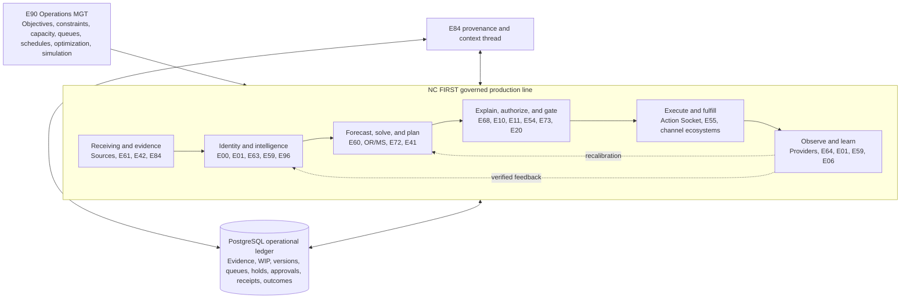

# E90 Operations MGT Ecosystem Architecture

**Document ID:** E90-OPERATIONS-MGT-2026-09-02  
**Version:** 0.1.0-controlled-draft  
**Identity state:** E90 NAME AND PURPOSE DESIGNATED BY ED ON 2026-09-02  
**Implementation state:** ARCHITECTURAL DRAFT, NOT BUILT, NOT DEPLOYED, NOT LIVE PROOF  
**Decision owner:** J. Edgar Broyhill II  
**Quantitative parent:** `NC_FIRST_PREDICTIVE_TO_PRESCRIPTIVE_OPERATIONS_SYSTEM_2026-09-02.md`  
**Funnel parent:** `UNIFIED_NEWS_TO_MICROSEGMENT_TO_FUNNEL_PROCESS_CONTRACT_2026-09-02.md`  
**Restoration relationship:** Adds E90's operating-model boundary only. It does not change the approved restoration sequence, assign other unresolved ecosystem identities, authorize a dry run, or authorize deployment.

## Governing idea

**E90 Operations MGT** treats NC FIRST as a digital manufacturing system.

- Each ecosystem is a specialized workstation.
- Data, evidence, campaign objects, approvals, and outcomes are the materials moving through the line.
- The database is the durable work-in-process, state, and traceability ledger.
- E84 is the provenance and context thread that explains where every material, rule, decision, and artifact came from.
- E00 is the governed movement and event fabric between stations.
- Quality, compliance, authorization, and candidate isolation are inspection gates.
- Channel ecosystems are fulfillment stations.
- Provider and first-party receipts are production evidence.
- Machine learning predicts quality, response, cost, timing, and risk.
- E90 Operations MGT uses Operations Research and Management Science to design, balance, schedule, and optimize the entire line.

The platform should not be modeled as 105 independent applications. It should be modeled as one governed production system composed of E001-E105 workstations.

## E90 mission

> **E90 Operations MGT has one purpose: OPTIMIZE EFFICIENCIES.**

E90 examines the entire production system rather than optimizing one ecosystem in isolation. Efficiency is measured across several dimensions:

- **Resource efficiency:** Use less money, compute, vendor capacity, staff effort, candidate time, and rework for each verified outcome.
- **Quality efficiency:** Increase first-pass yield, evidence completeness, contract conformance, identity accuracy, forecast calibration, decision reliability, compliance, and traceability.
- **Time efficiency:** Reduce lead time, cycle time, queue delay, approval delay, recovery time, and time from verified signal to governed action.
- **Flow efficiency:** Reduce idle work, duplication, conflicting handoffs, excess work in process, and bottleneck congestion.
- **Outcome efficiency:** Increase verified value per unit of total lifecycle cost and constrained capacity.

Quality and speed are therefore dimensions of efficiency, not separate purposes. Speed is never purchased by weakening quality, evidence, authorization, compliance, candidate isolation, or receipt requirements. Efficiency is never measured as cheap activity; it is measured against verified outcomes and total lifecycle cost.

E90 should expose the tradeoff explicitly:

\[
\max \operatorname{SystemEfficiency}
\]

where `SystemEfficiency` is a governed multi-dimensional measure of resource, quality, time, flow, and outcome efficiency, subject to hard constitutional, legal, ethical, security, authorization, isolation, capacity, and traceability constraints. The measurement definitions, component weights, and constraint versions must be governed and visible.

## Assembly-line diagram



The named ecosystems are orientation anchors, not a final assignment of every station. The approved census must place every E001-E105 ecosystem into the line without inventing identities for empty or disputed slots.

## The production vocabulary

| Manufacturing concept | NC FIRST equivalent |
|---|---|
| Raw material | Source records, news, donor facts, candidate facts, consent, costs, calendars, vendor state |
| Bill of materials | Exact input object versions required for a plan, journey, package, authorization, or execution |
| Work order | Versioned campaign, enrichment, quality, or operational task |
| Workstation | One ecosystem with a bounded purpose and typed input/output contract |
| Conveyor | E00 event movement, queues, outboxes, and governed handoffs |
| Work in process | Evidence or objects accepted by one station but not yet completed by the next |
| Routing sheet | Cross-contract manifest and ecosystem dependency graph |
| Machine setup | Model, policy, taxonomy, schema, solver, adapter, or prompt version |
| Inspection gate | Validation, quality, compliance, authorization, or current-state check |
| Hold area | Quarantine, exception, ambiguity, conflict, or stale-object queue |
| Finished good | Verified campaign outcome, delivered service, resolved identity, or completed operational objective |
| Scrap | Rejected input that is retained with evidence and reason, never silently erased |
| Rework | Corrected, superseded, or reprocessed object with preserved lineage |
| Lot and serial traceability | Candidate scope, tenant scope, object version, hash, correlation, causation, and receipt chain |
| Production telemetry | Queue depth, cycle time, throughput, failure, delivery, response, cost, and quality evidence |
| Continuous improvement | E01/E59 learning, model calibration, solver refinement, policy improvement, and future re-solving |

## The database is the factory ledger

The database is not merely storage behind the ecosystems. It is the shared operational substrate that records the condition of the line.

It must distinguish:

1. **Raw evidence:** Immutable source observations and provenance.
2. **Accepted material:** Validated records admitted to a governed process.
3. **Work in process:** Objects currently waiting, transforming, validating, or reconciling.
4. **Versioned assemblies:** Audience snapshots, forecasts, solves, plans, journeys, content packages, and authorization-bound objects.
5. **Inspection state:** Pass, hold, reject, stale, disputed, corrected, or superseded.
6. **Queue state:** Ready time, priority, owner, dependency, attempt, lease, and next action.
7. **Authorization state:** Exact object version, grant, scope, conditions, expiry, revocation, and consumption.
8. **Execution state:** Requested, provider accepted, delivered, failed, ambiguous, retried, or reconciled.
9. **Outcome state:** Engagement, response, RSVP, attendance, donation evidence, cost, attribution, correction, and finality.
10. **Learning state:** Consumer-specific acceptance, prior and new model or membership version, and recalibration lineage.

Chat output, model prose, and dashboards may describe the line. They are not the line's system of record.

## E84 is the digital thread

In manufacturing, a digital thread connects requirements, design, production, inspection, and field performance. E84 serves that role for NC FIRST.

For every consequential object, E84 should enable an authorized agent or human to determine:

- what the object is;
- which ecosystem owns it;
- which evidence and rules produced it;
- which versions were used;
- which object it superseded;
- which downstream objects depend on it;
- what proof state it has;
- whether it is current, stale, disputed, or held;
- what authorization applies;
- what execution and outcome receipts resulted;
- what later learning changed because of it.

E84 does not replace the operational database or execute workflows. It makes the production system understandable, recoverable, and auditable.

## Textbook-to-live decision architecture

E90 combines established Operations Management knowledge with current platform evidence through five distinct layers:

```text
E84 method library
  -> RAG retrieves relevant models, formulas, assumptions, and prior cases
  -> governed agent proposes a typed problem formulation
  -> PostgreSQL supplies current station, queue, capacity, quality, and cost evidence
  -> Gurobi, OR-Tools, HiGHS, statistics, or simulation computes the result
  -> Dataiku records checks, scenarios, metrics, lineage, and model drift
  -> E90 publishes an efficiency recommendation and proof receipt
  -> authorized owner decides whether implementation work may begin
```

LangChain documents SQL agents that inspect available tables and schemas, generate and check queries, execute them, and formulate responses, including human-in-the-loop patterns ([LangChain SQL agent](https://docs.langchain.com/oss/python/langchain/sql-agent)). E90 may use this pattern only through a governed read-only database role and an approved-query boundary.

RAG and agents are not the optimizer:

- RAG retrieves candidate methods and relevant evidence.
- The formulation agent translates the business problem into typed variables, objectives, constraints, assumptions, and required inputs.
- A deterministic validator rejects incomplete or unsafe formulations.
- The selected mathematical solver computes the result.
- Dataiku records the workflow, checks, model evaluations, and drift.
- E90 emits a recommendation with uncertainty and proof state.

An agent may recommend reordering a queue. It may not reorder a production queue, change capacity, rewrite policy, or execute an external effect without the separate authority and implementation path required by the affected ecosystem.

### Operations method library

E84 should index the conceptual and documentary source for each method, while E90 maintains a machine-readable registry that specifies:

- method identity and version;
- decision problem class;
- required inputs and units;
- mathematical assumptions;
- objective and constraint template;
- suitable solver;
- scale limits;
- validation tests;
- failure and infeasibility behavior;
- evidence and authority references;
- supersession lineage.

The initial method library includes Little's Law, Theory of Constraints, line balancing, EOQ and reorder-point logic, JIT/CONWIP release control, queueing models, assignment, knapsack, min-cost flow, LP/MIP, CP-SAT, PERT/CPM, SPC, EWMA/CUSUM, discrete-event simulation, Monte Carlo, robust optimization, stochastic optimization, and sensitivity analysis.

## E001-E105 station register

The completed census should produce one station record for every ecosystem number from E001 through E105. Empty and disputed numbers remain explicitly labeled rather than silently filled.

Each station record should contain:

```yaml
ecosystem_station:
  ecosystem_id: E000
  canonical_name: null
  authority_state: UNASSIGNED
  production_role: null
  purpose: null
  station_class: null
  owner: null
  system_of_record: null
  input_contracts: []
  output_contracts: []
  upstream_stations: []
  downstream_stations: []
  database_reads: []
  database_writes: []
  queue_or_outbox: null
  capacity_unit: null
  nominal_capacity: null
  cycle_time_target: null
  service_level: null
  quality_gates: []
  hold_conditions: []
  authorization_class: null
  idempotency_boundary: null
  proof_receipts: []
  deployed_state: UNKNOWN
  evidence_anchors: []
  unresolved_conflicts: []
```

No ecosystem is operationally defined until its inputs, outputs, system of record, capacity, gates, and receipts are known.

## Station classes

Each ecosystem should receive one primary station class:

- **Source and receiving**
- **Identity and reconciliation**
- **Evidence and context**
- **Feature and intelligence production**
- **Prediction and forecasting**
- **Optimization and decision**
- **Planning and orchestration**
- **Composition and assembly**
- **Quality and compliance inspection**
- **Human authorization**
- **Execution and fulfillment**
- **Observation and measurement**
- **Learning and calibration**
- **Infrastructure and reliability**
- **Governance and audit**
- **Archive and recovery**
- **Unassigned or held**

A station may support other functions, but it must have one primary production responsibility so that ownership and bottlenecks remain visible.

## OR/MS control of the line

The OR/MS layer should optimize two different things.

### Product-flow optimization

Choose the best feasible campaign or operational action:

- donor;
- candidate;
- purpose;
- microsegment;
- ask;
- channel;
- content package;
- timing;
- sequence;
- budget;
- event or RSVP action;
- stewardship action.

### Production-flow optimization

Improve how the platform itself performs:

- which station receives work next;
- how much work may enter a station;
- which queue receives priority;
- where batching reduces cost without creating dangerous delay;
- where parallel processing is safe;
- where serialized processing is constitutionally required;
- how to allocate compute, vendor capacity, staff time, and candidate time;
- when a bottleneck requires more capacity or a policy change;
- when work should be held rather than retried;
- how to minimize cycle time, rework, failure, and ambiguous external effects;
- how to recover after a station or vendor outage.

This is the crucial extension: OR/MS optimizes both **what the campaign should do** and **how the platform produces that decision and action**.

## Core factory metrics

| Metric | Definition | Why it matters |
|---|---|---|
| **Lead time** | Time from admitted evidence or demand to verified outcome | Measures total responsiveness |
| **Cycle time** | Active processing time at one station or stage | Reveals slow transformations |
| **Queue time** | Time waiting before a station begins work | Exposes hidden delay |
| **Throughput** | Completed valid objects per unit of time | Measures productive flow |
| **Work in process** | Accepted objects not yet completed | Too much WIP hides congestion and staleness |
| **First-pass yield** | Share completing without rework or correction | Measures contract and data quality |
| **Rework rate** | Share requiring correction, supersession, or rerun | Exposes bad inputs and unclear contracts |
| **Hold rate** | Share stopped by quality, authority, compliance, or ambiguity | Distinguishes safe control from failure |
| **Constraint utilization** | Used capacity divided by permitted capacity | Identifies overload and unused resources |
| **Bottleneck contribution** | Delay attributable to a binding station or constraint | Directs improvement effort |
| **On-time completion** | Share completed before expiry or service deadline | Protects time-sensitive opportunities |
| **Cost per verified outcome** | Full operational cost divided by reconciled outcomes | Prevents cheap but ineffective activity |
| **Ambiguous-effect rate** | External requests lacking a conclusive receipt | Critical fail-closed reliability measure |
| **Traceability completeness** | Share with complete input-to-outcome lineage | Determines whether learning is admissible |

### E90 improvement findings

Every E90 efficiency finding should identify:

1. the affected station or handoff;
2. the measured baseline;
3. whether the loss concerns efficiency, quality, speed, or more than one;
4. the suspected bottleneck or failure mechanism;
5. the recommended change;
6. expected benefit and uncertainty;
7. affected constraints and risks;
8. simulation or dry-run evidence;
9. the owner authorized to accept or reject the change;
10. the post-change measurement needed to verify improvement.

E90 recommendations are improvement proposals. They do not silently modify another ecosystem, database object, policy, queue, model, or production service.

## Line balancing

The platform should not maximize activity at each ecosystem independently. Local optimization can flood downstream queues, create stale audiences, waste candidate attention, or increase compliance risk.

The OR/MS layer should balance the line by:

1. measuring arrival rate, service rate, capacity, failure, and queue time at each station;
2. identifying the current system bottleneck;
3. limiting upstream release when downstream WIP exceeds policy;
4. allocating scarce resources to the highest-value feasible work;
5. protecting constitutionally serialized gates from unsafe parallelization;
6. simulating proposed capacity or policy changes before adoption;
7. measuring whether the change improved end-to-end outcomes rather than one local metric.

## Quality at the source

Defects should be stopped where they originate.

- E42 must not emit unattributed or unversioned news as actionable evidence.
- E63 must not emit heat without scale, decay, provenance, and expiry.
- E59 must not emit an audience without definition, membership, exclusions, and snapshot version.
- Predictive models must not emit uncalibrated point estimates as certainty.
- The OR/MS solver must not accept incomplete constraint sets.
- E72 must not assemble a plan from stale or incompatible inputs.
- E68 must not authorize a mutable object.
- E20 must not accept expired authorization or stale current-state evidence.
- The Action Socket must not retry an ambiguous external effect blindly.
- E64 must not transform first-party behavior into scoring, segmentation, authorization, or dispatch.
- Learning consumers must not learn from unverified or incorrectly attributed outcomes.

## Bottleneck doctrine

The slowest or most constrained station determines system throughput. The current bottleneck may be:

- missing evidence;
- unresolved identity;
- unavailable database capacity;
- stale heat or audience state;
- solver infeasibility;
- human approval;
- compliance review;
- candidate time;
- channel consent;
- vendor throughput;
- provider ambiguity;
- outcome reconciliation;
- incomplete learning.

The system must identify the active bottleneck from receipts and queue state. It must not assume that more messages, more models, or more automation will increase throughput.

## E90 boundary

E90 Operations MGT is the industrial-engineering and operations-decision layer for the ecosystem assembly line:

- maintain objective and constraint contracts;
- solve allocation, scheduling, assignment, routing, and capacity problems;
- simulate line changes;
- identify bottlenecks and shadow prices;
- recommend line balancing and resource changes;
- publish versioned solver and sensitivity receipts;
- never own source evidence;
- never silently rewrite another ecosystem's object;
- never authorize;
- never dispatch directly.

## Integration with E60, E72, E68, and E20

E90 joins the existing Wizard-first production sequence without replacing it:

```text
E60-owned Dataiku and predictive services
  -> E90 efficiency analysis and recommendation
  -> E72 Campaign Plan Object when campaign-facing
  -> E68 Wizard explanation and exact-version authorization
  -> E20 current-state gates and route classification
  -> Action Execution Socket only when the authorized effect is an external action
```

For platform-efficiency changes, E68 presents a dedicated Operations MGT card and E20 routes an authorized implementation work order to the affected ecosystem. E20 does not apply schema, code, infrastructure, configuration, or queue changes directly.

The controlling interface is `contracts/E90_E20_E68_INTEGRATION_CONTRACT_2026-09-03.md`. Every E90 recommendation declares `execution_allowed: false`; recommendation, authorization, E20 acceptance, implementation, execution, outcome, and verified efficiency improvement remain separate states.

## Acceptance criteria

The assembly-line model is complete only when:

1. every E001-E105 number has a verified station record or an explicit `UNASSIGNED` state;
2. every active station has typed inputs and outputs;
3. all database reads and writes are mapped;
4. every inter-station handoff has a durable receipt;
5. WIP and queue state are measurable;
6. capacity and cycle-time units are defined;
7. quality, hold, and rejection states are explicit;
8. bottlenecks can be identified from evidence;
9. prediction and optimization remain separate;
10. optimization and authorization remain separate;
11. authorization and execution remain separate;
12. provider acceptance, delivery, response, conversion, and learning remain separate;
13. simulation and dry-run evidence cannot become live proof;
14. E64 remains first-party behavior and RSVP management only;
15. a complete source-to-outcome-to-learning trace can be reconstructed.

## Final statement

The platform is not merely a collection of ecosystem capabilities. It is a governed production line.

The database carries the state of production. E84 preserves the digital thread. E00 moves governed work. The ecosystems transform it. ML estimates what may happen. OR/MS balances the line and determines the best feasible next action. Humans authorize consequential action. Execution ecosystems fulfill it. Receipts measure what actually happened. Learning improves the next production cycle.

That is how NC FIRST becomes efficient, recoverable, explainable, and increasingly self-operating without surrendering constitutional human control.
